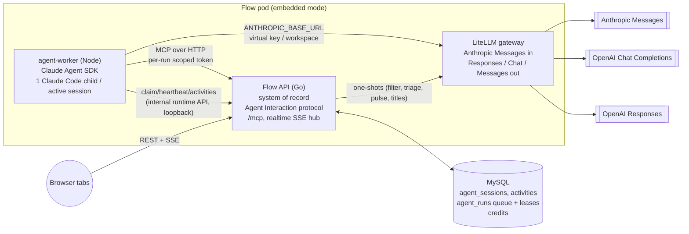
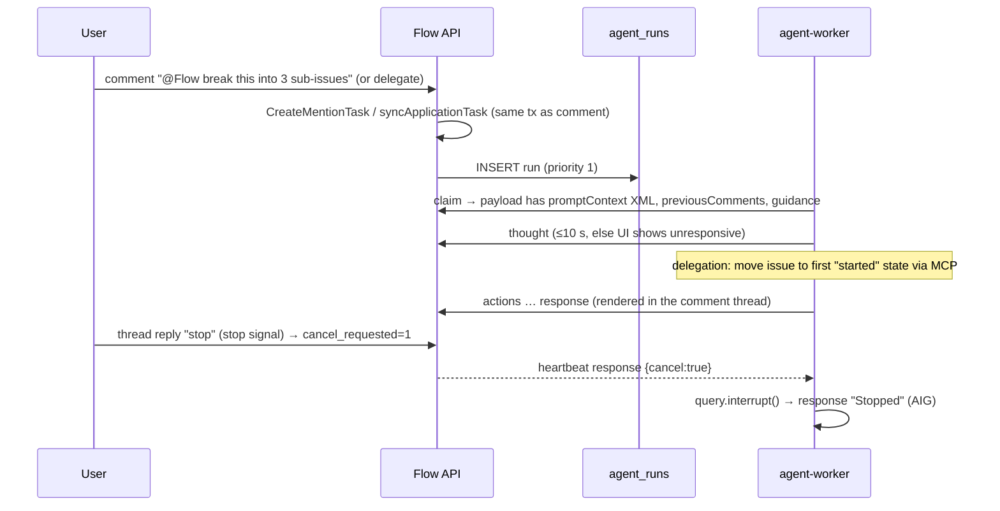
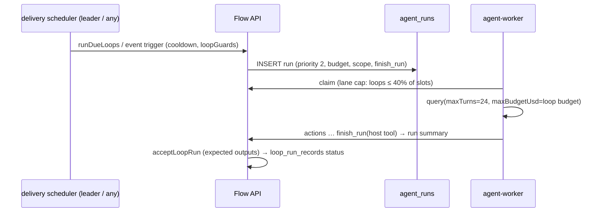
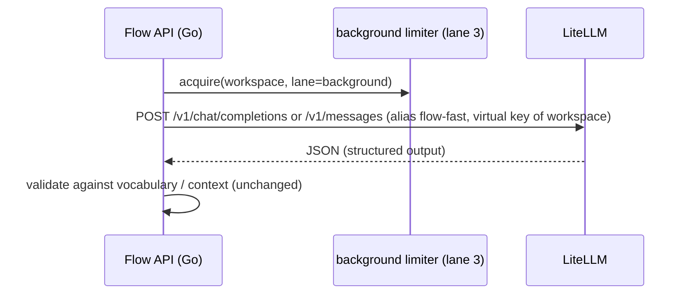
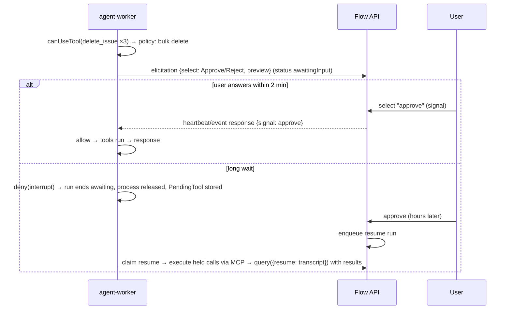

# Agent runtime v2: Claude Agent SDK worker behind a protocol gateway

Status: design + spike, 2026-10-13. Owner: agent platform. Spike code: [`agent-runtime/`](../agent-runtime).

## 中文摘要

- **决定**：把 Flow 的 agent 核心从 Go API 进程内的手写工具循环（`agent_stream.go` 的 `runAgentSession`，最多 8 轮）拆成独立的 **agent worker 运行时**。worker 用 **Claude Agent SDK** 作为 harness，模型流量统一经过开源协议转换网关 **LiteLLM**（对 worker 暴露 Anthropic Messages，上游可以是 OpenAI Chat Completions、OpenAI Responses 或 Anthropic Messages）。
- **Flow API 仍是唯一的数据源**：会话、activity、审批、change set 都在 Flow 里。内置 agent 也走和外部 agent 相同的 Agent Interaction 协议（session / activity / signal）。worker 没有数据库凭据，只通过 Flow 的 `/mcp`（每个 run 一个短期、限定范围的 token）和内部 runtime API 访问数据。
- **部署**：先做**嵌入式**——worker 作为同一个 pod 里的 sidecar，队列用 MySQL 行租约（不启用 Redis），网关用 LiteLLM。之后可以扩展成集群：Redis Streams 或 NATS 作队列，worker 按队列深度自动扩缩。
- **调度**：分优先级通道（chat > 评论线程/委派 > loops > 后台），再加每个 workspace 的并发配额、公平调度、全局模型限流和 AI credit 计费，保证 Go 应用和交互式请求不会被饿死。
- **Spike 结论**（数字见 [§16](#16-spike-results)）：
  - 两个协议都能完整跑通：Flow MCP 工具、`ask_user`、审批、stop、中文。15 个用例三组都是 15/15 通过。
  - 发现 LiteLLM 1.105 在流式转换并行工具调用时会丢参数，需要设置 `parallel_tool_calls: false` 规避。
  - 每个会话会起一个 Claude Code 子进程，常驻内存约 **200–280 MB**，所以单个 worker 的并发主要受内存限制。
  - 因为 90 个工具 schema 全部预加载，每次模型调用约 **17k input tokens**。
- **建议**：
  - **Go**：Responses 协议，作为主路径，灰度上线（前提是带上 §16.3 的修复）。
  - **有条件 Go**：Chat Completions 协议，仅作为兼容和备用路径。
  - 不过，Claude Agent SDK 是专有许可（Anthropic Commercial Terms），而且官方不支持非 Claude 模型。所以必须先完成法务评审，并把 harness 抽象成可替换的接口。

---

## 1. Goals and non-goals

### Goals

1. **Isolation.** Agent runs must never starve the Go API. Today a chat turn runs inside the HTTP request goroutine with a detached context, holds workspace mutation locks while persisting, and there is no global cap on concurrent chat runs (`agentRuns` is just a `sync.Map`).
2. **One runtime for every agent surface.** This covers in-app chat, comment threads and delegation, loops, and agent-initiated sessions. Every surface speaks Flow's Agent Interaction protocol (sessions, activities, signals), which already exists for application agents (`application_agents.go`, `agent_session_api.go`).
3. **Any model protocol.** The OpenAI Chat Completions, OpenAI Responses and Anthropic Messages protocols all go through one open-source gateway, so model choice is configuration rather than Go code. `agent_provider.go` currently hand-rolls 1,060 lines for three protocols.
4. **A better harness for free.** The Claude Agent SDK brings:
   - streaming input, interrupt, permission callbacks (`canUseTool`), hooks;
   - MCP client, auto-compaction, retries, budget limits (`maxTurns`, `maxBudgetUsd`);
   - session transcripts, OTel.
5. **Embedded first.** The default deployment must run as a sidecar next to the API with only MySQL (no Redis). It must grow to a cluster (Redis Streams/NATS, autoscaling) without a data-model change.
6. **Capacity.** Hundreds to thousands of concurrent *users*, with per-workspace fairness, model rate limits and AI-credit accounting.

### Non-goals

- Coding sessions (repo checkout, bash, file edits). The worker runs with every built-in tool disabled. Coding sessions are a separate, sandboxed product (`CodingAgentSettings`) and can reuse the queue later.
- Replacing Flow's MCP server or tool implementations. The tools stay in Go and keep their permission model.
- Changing the external application-agent API (webhooks, `/api/agent-tasks`). The built-in agent becomes one more consumer of it.
- One-shot features (AI filter, Triage Intelligence, Pulse summaries, chat titles) do not need an agent harness. They move to the gateway (§7.5) but stay in Go.

## 2. Today (baseline)

| Concern | Today | Problem at scale |
|---|---|---|
| Chat loop | `runAgentSession` in the request goroutine; 8 tool turns; reply persisted once at the end into the workspace JSON blob | No queue, no cap. A crash loses the reply. Persisting takes the workspace write lock. |
| Streaming | The per-request SSE goes only to the requesting tab. Other tabs get `agent.message_completed` from the realtime hub. | No fan-out of deltas; no reattach after reload. |
| Stop / approvals | `agentRuns`, `agentApprovals`, `agentElicitations` are process-local maps | Breaks with more than one API process unless routing is sticky. |
| Threads / delegation | `application_agent_tasks` plus activities in SQL, a 4-slot worker per process, CAS row claim, 5-minute lease | Good model. Reuse it. |
| Loops | `loop_run_records` with lease and heartbeat (60 s / 15 s); 2 per workspace, 4 per process | Reuse the lease pattern. |
| One-shots | Share the agent provider client, with no global semaphore (triage has 4 slots) | Unbounded model concurrency. |
| Providers | Three hand-written protocol clients. Reasoning is never replayed. Anthropic gets no `cache_control`. | Protocol drift; every new model feature is Go work. |

Detailed inventory: `scratchpad/agent-research/flow-agent-inventory.md` and §1–15 of the code survey behind this doc.

## 3. Architecture



### Responsibilities

**Flow API (Go)** owns everything durable:
- sessions, activities, signals;
- the run queue and leases;
- per-run token minting, the tool implementations (`/mcp`), approvals, change sets and attribution;
- credits and quotas;
- the realtime fan-out to browsers.

It renders the system prompt (workspace, team and personal guidance, skills, `promptContext`) and puts it in the run payload, so the worker stays generic.

**agent-worker (TypeScript)** is stateless apart from in-flight runs. For each claimed run it:
1. spawns a Claude Code child through `query()`;
2. connects the child to Flow's `/mcp` (the only tool source) and to the in-process host tools (`ask_user`, `finish_run`, `report_progress`);
3. maps SDK messages to activities (§5) and posts them back;
4. honours stop, approval and select signals.

It has **no DB credentials** and no Flow secrets beyond the run token and its own worker credential.

**LiteLLM** handles protocol translation (Anthropic Messages to OpenAI Responses or Chat Completions, or Anthropic pass-through). It also owns model aliases, virtual keys per workspace, budgets, rate limits (rpm/tpm), fallbacks, retries and spend logs.

The **queue** is a MySQL table `agent_runs` with CAS row leases (embedded mode). In cluster mode, Redis Streams or NATS JetStream carry run ids and MySQL stays the state of record.

### Why the built-in agent speaks the Agent Interaction protocol

Today, threads and delegation already store `AgentTask` plus `AgentActivity`. Chat uses a different model: `AgentSession.Messages` in the workspace blob.

v2 unifies them. Every conversation is an **agent session row** (generalising `application_agent_tasks` with `resource_type = chat | issue | project | document | loop`), and its history is the **activity log**. The worker is "just another agent" that receives `created` and `prompted` events through the queue instead of a webhook.

This gives us:
- one stop, approval and select mechanism;
- one history source;
- one UI renderer, with streaming in threads and chat alike;
- external agents and the built-in agent behaving identically, as the AIG requires.

## 4. Data model (new and changed)

```sql
-- generalises application_agent_tasks (keep the table; add columns), chat sessions move out of the workspace blob
ALTER TABLE application_agent_tasks
  ADD COLUMN kind VARCHAR(16) NOT NULL DEFAULT 'thread',   -- chat | thread | delegation | loop | background
  ADD COLUMN transcript_ref VARCHAR(128) NULL;             -- SDK session id / transcript key (§6.4)

CREATE TABLE agent_runs (                -- one row per "turn to execute" (created / prompted / resume / retry)
  id              VARCHAR(64) PRIMARY KEY,
  workspace_key   VARCHAR(64) NOT NULL,
  session_id      VARCHAR(64) NOT NULL,  -- agent session (task) id
  kind            VARCHAR(16) NOT NULL,  -- chat | thread | loop | background
  priority        TINYINT NOT NULL,      -- 0 chat, 1 thread/delegation, 2 loop, 3 background
  status          VARCHAR(16) NOT NULL,  -- queued | leased | running | awaiting | done | failed | canceled | interrupted
  lease_owner     VARCHAR(64) NOT NULL DEFAULT '',
  lease_until     BIGINT NOT NULL DEFAULT 0,      -- unix ms, same convention as webhook_deliveries
  heartbeat_at    BIGINT NOT NULL DEFAULT 0,
  next_attempt_at BIGINT NOT NULL,
  attempts        INT NOT NULL DEFAULT 0,
  cancel_requested TINYINT NOT NULL DEFAULT 0,
  wrote           TINYINT NOT NULL DEFAULT 0,     -- a write tool succeeded (controls auto-retry, §11)
  payload         LONGBLOB NOT NULL,              -- prompt, rendered system prompt, tool groups, limits, model alias
  usage           JSON NULL,                      -- tokens / cost from the result message
  created_at      BIGINT NOT NULL, updated_at BIGINT NOT NULL,
  KEY claim (status, priority, next_attempt_at),
  KEY ws_running (workspace_key, status)
);

CREATE TABLE agent_credit_ledger (workspace_key VARCHAR(64), run_id VARCHAR(64), model VARCHAR(64),
  input_tokens BIGINT, output_tokens BIGINT, cache_read_tokens BIGINT, cost_micros BIGINT, created_at BIGINT,
  PRIMARY KEY (workspace_key, run_id, model));
```

`application_agent_activities` stays the append-only log. Activities get a client-supplied `activityId` (idempotent upsert) and an `ephemeral` flag (already accepted by the session API).

## 5. Event mapping (SDK to Flow activities)

The worker consumes `SDKMessage`s (`includePartialMessages: true`) and produces activities. The spike prints exactly this mapping (`agent-runtime/src/worker.ts`).

| SDK message | Flow activity | Durable? | Today's chat SSE equivalent |
|---|---|---|---|
| process start, `system/init` | `thought` "Working…" (ack), session `active` | yes (first activity, used for the AIG 10 s `unresponsive` rule) | `session.started` |
| `stream_event` text_delta | `text.delta` | **no**: realtime hub only, coalesced every 100 ms | `text.delta` |
| `stream_event` thinking_delta (Claude), reasoning summary (GPT via gateway) | `thought` | ephemeral | `reasoning.delta` (dropped today) |
| `assistant` with a `tool_use` block | `action {action, parameter}` | yes | `tool.started` |
| `user` with a `tool_result` block | `action {…, result}` (update in place) plus a change-set card if the result carries `change` | yes | `tool.completed` |
| `canUseTool` requests approval | `elicitation` + `select` signal [Approve, Reject] | yes, status `awaitingInput` | question part with `approval` |
| host tool `ask_user` | `elicitation` + `select` signal | yes, status `awaitingInput` | question part |
| `result` success | `response` (final markdown) plus usage on the run | yes, status `complete` | `session.completed` |
| `result` error / max turns / budget | `error` | yes | `error` |
| interrupt after a stop signal | `response` "Stopped" (AIG: halt, then respond) | yes, status `canceled` | `error` "Generation stopped" |

**Fan-out.** The worker posts batches to `POST /internal/agent-runtime/runs/{id}/events`:
- Durable activities are written with `expectedVersion` semantics, as today.
- Ephemeral events go straight to `publishRealtime`, using the existing per-workspace replay ring.

Every tab subscribed to the workspace SSE therefore sees the deltas, and a reloaded tab reattaches with `Last-Event-ID`. This fixes today's "only the posting tab streams" limitation. In cluster mode, cross-instance delivery already uses Redis pub/sub (`startCoordination`).

## 6. How existing features map

### 6.1 Tools: Flow MCP over HTTP with per-run scoped tokens

- **Tool source.** The worker passes `mcpServers.flow = {type:'http', url: <api>/mcp, headers:{Authorization: Bearer <run token>}}` and `tools: ['Read']`, which disables Bash, Edit, Write, WebFetch, WebSearch, Task and every other built-in. `Read` stays so the model can page through large MCP results that Claude Code spills to files (§16.3). It also passes `strictMcpConfig: true`, `settingSources: []`, a private `HOME`/`CLAUDE_CONFIG_DIR`, and a fully replaced `env`. `canUseTool` denies anything outside `mcp__flow__*` and `mcp__flowhost__*`, and allows `Read` only inside the session's private HOME. The spike verified this: `system/init` lists 92 tools (90 Flow, `ask_user` and the fenced `Read`) and nothing else.
- **Run token (new).** Today the built-in agent acts through an in-memory synthetic `domain.APIKey{Actor:"app", SubjectUserID}` plus `builtinInvokerContextKey`. Nothing can mint an "app on behalf of user" token for an out-of-process caller. Add `POST /internal/agent-runtime/runs/{id}/token`, which returns an opaque token with these properties:
  - It is a `domain.APIKey` with `Actor:"app"`, `OAuthClientID: builtin-flow-agent`, `SubjectUserID` = the invoking human and `AuthorizationUserID` = invoker. Effective access is the app's access intersected with the user's, exactly as `builtinApplicationContext` does today.
  - Scopes come from the run kind: chat gets read, write, create_*; loops get the loop's scope (teams, `allowChangesOutsideTrigger`, external sync).
  - It carries `TeamRestriction`/`TeamIDs` and a new **tool allowlist** (the chat tool groups from `agent_chat_tools.go`, or the loop's tools).
  - It has a `RunID` claim, so `/mcp` can stamp attribution and change sets.
  - TTL is the run timeout plus 5 minutes (15 minutes for chat, 15 minutes for loops). It is revoked when the run ends, and is never written to disk.
- **Attribution.** `/mcp` sets `User.Via = agentToolBotActor(...)` from the run token, so history reads "Flow … on behalf of X" with no worker involvement. Today's `agent_attribution.go` logic moves to the token path.
- **Tool economy.** Today, chat sends a 24-tool core set plus groups loaded on demand (`load_tools`). The SDK's MCP tool search (deferred loading) needs Anthropic betas that we disable for non-Claude upstreams, so all tools load upfront. The spike measured about **17k input tokens per model call with 90 tools** (§16). Keep the group mechanism:
  - The run token's allowlist filters `tools/list`.
  - `load_tools` becomes a host tool that calls `query.setMcpServers()` / reconnects the Flow server with a wider allowlist. The SDK supports dynamic MCP server changes.
  - With Claude upstreams, tool search can be re-enabled.

### 6.2 Approvals: `canUseTool` and the policy port

`agent-runtime/src/policy.ts` ports `agent_approval_policy.go`:
- bulk delete (more than one target in one model turn);
- an unrequested new `save_status_update`;
- `external_*` tools.

`canUseTool` fires per call, so the worker groups calls by the assistant message id (from `message_start`) and waits for `message_stop` before deciding. One approval then covers the whole turn's deletes.

Behind the gateway, parallel tool calls are disabled (§16.3), so a bulk delete arrives as sequential single-delete turns. The policy therefore also counts deletes per user request: the second delete asks once for the rest of the request. The spike verified this on both protocols. To restore all-at-once previews, Flow MCP should get batch delete tools (`ids[]`).

The answer path depends on how long the user takes:
- **Short wait** (user present, at most 2 minutes): post an `elicitation` + `select`, keep the lease, heartbeat, and resolve when the signal arrives through the internal API.
- **Long wait**: deny the call with `interrupt: true` and the message "held for approval", end the run as `awaitingInput` with the held calls stored in `PendingTool`, and release the process. When the user approves, Flow enqueues a `resume` run. The worker first executes the held calls directly through MCP (not through the model, as `resumeAgentApproval` does today), then continues the conversation with their results. A free-text reply such as "yes" or "批准" counts as approval (`isApprovalWord`).

### 6.3 `ask_user`

`ask_user` is a host tool in the in-process SDK MCP server (`createSdkMcpServer`), so its schema matches today's `agent_ask_user.go`. The handler posts an elicitation with a `select` signal and awaits the answer. Long waits use the same suspend/resume path as approvals. The SDK's built-in `AskUserQuestion` tool plus `canUseTool` is an alternative, but a host tool keeps the schema and UI identical across harnesses.

### 6.4 History and compaction

- **Primary history.** Each session keeps an SDK transcript, mirrored to Flow through the SDK `sessionStore` adapter (alpha). The adapter is backed by `POST /internal/agent-runtime/transcripts/{key}` into a `agent_transcripts` table, chunked and capped. A follow-up run resumes with `resume: <sdk session id>`, which rebuilds the exact message history, including Claude thinking blocks and tool ids.
- **Fallback history.** If the transcript is missing, the model alias changed protocol family, or it exceeds caps, the worker rebuilds the conversation from activities:
  - prompts, responses and elicitation answers become messages;
  - actions become compact tool-call summaries;
  - the AIG says to rebuild from activities, not comments.

  This is what `builtinThreadHistory` does today. It loses tool-call fidelity but is model-agnostic.
- **Compaction.** Claude Code auto-compacts near the context window. For gateway aliases it assumes 200k tokens unless told otherwise, so declare the real window per alias in worker settings (model config "correct the window for a gateway model ID"). The compaction call goes through the gateway and is billed to the run. This replaces today's crude limits: the last 32 messages, 8 MiB, and 40 provider messages.

### 6.5 Streaming and stop

- **Streaming.** See §5. Text deltas never touch MySQL.
- **Stop.** `POST /api/agent/sessions/{id}/stop` (chat) or a `stop` signal (threads) sets `agent_runs.cancel_requested=1` and publishes `agent_run.cancel` on the internal channel. The worker learns of it in one of two ways:
  1. Embedded mode: the internal API returns `cancel` on the next heartbeat or event-batch response, at most 1 s later.
  2. Cluster mode: a Redis/NATS control subject delivers it.

  The worker then calls `query.interrupt()`. In the spike, the stop signal took effect in **≤ 20 ms** and the session stayed usable for a follow-up (§16). Tool calls already sent to `/mcp` complete server-side. The run records them, and the next turn sees "cancelled" results, which avoids today's "No tool output found" poisoning class of bugs.

### 6.6 Undo and change sets

Today `executeAgentToolRecordingChange` wraps the in-process tool call. In v2 the snapshot moves into `/mcp`: when the token carries a `RunID`, the write tool path:
1. records `before` and `after` exactly as `beginAgentChange` and `finishAgentChange` do;
2. stores the `AgentChange` keyed by `(run_id, seq)`;
3. returns `structuredContent.change = {id, action, entityType, entityId, undoable}` in the tool result.

The worker copies it into the `action` activity, and the UI renders "Updated project / Undo / Restore" from activities. Undo and restore endpoints keep their current semantics. The process-local `agentChangeLocks` become a row lock (`SELECT … FOR UPDATE` on the change row; sqlite uses a CAS on version).

### 6.7 Comment threads, delegation and loops

- **Threads and delegation.** Mention or delegation creates the task (unchanged). Instead of `executeBuiltinApplication` in-process, Flow enqueues an `agent_runs` row (priority 1). On delegation, AIG behaviour is: move the issue to the first started state, then ack within 10 s.
- **Loops.**
  - A loop run becomes an `agent_runs` row (priority 2) whose payload carries the loop instructions and scope.
  - `finish_run` is a host tool.
  - Limits map as follows: `maxTurns` = `FLOW_LOOP_MAX_TURNS`, `maxBudgetUsd` from the loop's credit budget, and the run lease timeout = `FLOW_LOOP_RUN_TIMEOUT`.
  - `loopScope` enforcement stays in `/mcp` through the token's scope.
  - The loop-run event log (`loop_run_events`) is fed from activities.
- **External MCP connectors (`external_*`).** These stay proxied by Flow, which holds the credentials and handles connector elicitation. They are exposed through `/mcp` to the run token only when the workspace or loop allows them. The worker never sees connector credentials.
- **Web search.** The Anthropic server-side `web_search` tool doesn't exist behind a non-Anthropic gateway. Expose Flow's `web_search` and `fetch_url` (SSRF-safe) through `/mcp` when `agentWebSearch` is on.

## 7. Sequence diagrams

### 7.1 Chat turn

```mermaid
sequenceDiagram
  participant B as Browser
  participant A as Flow API
  participant Q as agent_runs (MySQL)
  participant W as agent-worker
  participant C as Claude Code child
  participant G as LiteLLM
  B->>A: POST /api/agent/sessions/{id}/messages {message}
  A->>A: append prompt activity (session pending)
  A->>Q: INSERT run (priority 0, payload: prompt, rendered system prompt, tool groups)
  A-->>B: 202 {sessionId, runId}  (UI listens on workspace SSE)
  W->>A: POST /internal/agent-runtime/claim {lanes, capacity}
  A->>Q: CAS lease (status queued→leased, lease_until=now+60s)
  A-->>W: run + payload + run token (scoped, 15 min)
  W->>A: thought "Working…" (ack ≤ 1 s)
  W->>C: query({prompt, systemPrompt, mcpServers.flow=/mcp+token, tools:[]})
  C->>G: POST /v1/messages (stream)
  G-->>C: SSE deltas (translated from Responses/Chat)
  C-->>W: stream_event text_delta …
  W->>A: events batch (ephemeral deltas) → publishRealtime → all tabs
  C->>A: MCP tools/call save_issue (Bearer run token)
  A-->>C: result + structuredContent.change
  W->>A: action activity (durable)
  C-->>W: result {usage, cost}
  W->>A: response activity + usage → credits ledger; run done; token revoked
```

### 7.2 Comment thread or delegation



### 7.3 Loop run



### 7.4 Triage, AI filter and other one-shots (no harness)



### 7.5 Ask user, approvals and resume



### 7.6 Undo

```mermaid
sequenceDiagram
  participant U as User
  participant A as Flow API
  U->>A: POST /api/agent/sessions/{id}/changes/{changeId}/undo
  A->>A: lock change row; revert fields still equal to "after"; skip edited fields
  A-->>U: change state=undone (card shows Restore)
```

## 8. Queue design

### 8.1 Embedded mode: MySQL row leases (no Redis)

- Workers never touch MySQL. They call `POST /internal/agent-runtime/claim {workerId, free: {chat:n, thread:n, loop:n, background:n}}`, and the Go API runs the claim.
- The claim reuses the portable CAS pattern of `ClaimApplicationTask` and `ClaimWebhookDelivery`:

  ```sql
  -- candidates (MySQL 8 / Postgres: add FOR UPDATE SKIP LOCKED inside a short tx; sqlite: plain select + CAS)
  SELECT id, workspace_key FROM agent_runs
   WHERE status='queued' AND next_attempt_at<=? AND priority IN (...lanes with free slots...)
   ORDER BY priority, next_attempt_at LIMIT 32;
  -- fairness filter in Go (§9), then for each chosen id:
  UPDATE agent_runs SET status='leased', lease_owner=?, lease_until=?+60000, attempts=attempts+1, updated_at=?
   WHERE id=? AND status='queued';            -- RowsAffected==1 wins
  ```

- Heartbeat every 15 s:

  ```sql
  UPDATE agent_runs SET lease_until=now+60s, heartbeat_at=now WHERE id=? AND lease_owner=?
  ```

  The response carries `cancel_requested` and any pending signal, so cross-process stop needs no new channel.
- A reconciler runs every 30 s on any instance. Leases that expired while `leased` or `running` go back to `queued` if no write happened (`wrote=0`, attempts < 2). Otherwise they become `interrupted` and an `error` activity is posted (§11).
- Wake-up: `INSERT` calls a local `kick()`. The worker long-polls `claim` (it is held up to 20 s server-side and woken by an in-process condition variable when a run is enqueued), so idle CPU is near zero and pickup latency is under 50 ms.

### 8.2 Cluster mode: Redis Streams or NATS

MySQL stays the source of truth (status, lease, attempts). The stream carries only `{runId, workspace, priority}`:
- **Redis Streams.** One stream per lane (`agent:runs:p0…p3`) with consumer group `workers`, `XREADGROUP` by lane weights, `XAUTOCLAIM` for dead consumers, and `XACK` on terminal status.
- **NATS JetStream.** A WorkQueue stream with subjects `agent.runs.p{n}.{workspace}`, `MaxAckPending` per consumer for back-pressure, and `AckWait` equal to the lease.

The claim still does the MySQL CAS, which keeps it idempotent if the stream redelivers. Control messages (cancel, signals) move to pub/sub (`agent.ctl.{runId}`).

## 9. Scheduling and fairness

| Lane | Work | SLO | Default share of a worker's slots |
|---|---|---|---|
| P0 chat | user waiting on the screen | pickup < 200 ms, first activity < 1.5 s | may use 100% |
| P1 threads / delegation | AIG: ack within 10 s | pickup < 2 s | ≤ 75% |
| P2 loops | scheduled or event | minutes | ≤ 40% |
| P3 background | triage, pulse, titles (gateway one-shots, Go-side limiter) | best effort | ≤ 20% |

- **Caps are ceilings, not reservations**, so idle capacity is used. A P0 run never waits behind P2 or P3, because P2 and P3 can't hold more than their caps. When P0 is saturated, P2 runs are pushed back (`next_attempt_at += jitter`) rather than preempted.
- **Per-workspace quotas.** Default limits:

  | Scope | Limit |
  |---|---|
  | Workspace | ≤ 8 concurrent runs |
  | User (chat) | ≤ 3 concurrent runs |
  | Loops | ≤ 2 concurrent (today's default) |
  | Queue | 200 queued runs per workspace |

  Fairness uses deficit round-robin across workspaces within a lane. Among candidates, prefer the workspace with the fewest running runs relative to its plan weight. When over quota, the run stays queued and the UI says "Waiting for capacity…" through an ephemeral thought.
- **Global model rate limiting.** LiteLLM `rpm`/`tpm` per deployment, plus per virtual key (workspace). On a 429 with `retry-after`, Claude Code backs off by itself; set `CLAUDE_CODE_MAX_RETRIES` low and let the gateway own retries, so retries don't double up. The Go side keeps one token bucket per lane for one-shots (existing `TakeTokens` in Redis mode, in-memory otherwise).
- **AI credits.**
  - Preflight: a run is claimable only if the workspace balance is above zero and the run's `maxBudgetUsd` fits.
  - Post-run: the `result.modelUsage` tokens plus cost are written to `agent_credit_ledger`. LiteLLM's spend log is the reconciliation source, keyed by run id via `metadata` and the `x-claude-code-session-id` header.
  - In-run: `maxBudgetUsd` stops a runaway loop.

## 10. Worker process model

- **One child per active session.** `query()` spawns a Claude Code child (the native binary from the SDK's platform package, about 240 MB on disk). Spike numbers: **idle about 190 MB RSS, peak about 200–295 MB RSS per session** (mean 256–260 MB on the eval). Spawn plus MCP connect to `init` was p50 0.25 s and p90 1.8 s, with the first cold spawn about 5 s. See §16 for the full figures.
  - So a worker's concurrency is **memory-bound**: about 4 sessions per GB, plus a Node parent of about 100 MB.
  - CPU is negligible while waiting on the model; spikes come at spawn and during JSON parsing.
- **Slots.**

  | Mode | Defaults |
  |---|---|
  | Embedded sidecar | 2 GiB pod budget, so 6 slots (P0 may use 6, P1 4, P2 2, P3 1) |
  | Cluster | 8 GiB workers with 24 slots, autoscaled |

- **Lifecycle.**
  - A child lives for one run (one prompt through its result), or across a short conversation burst when the next prompt arrives within 60 s (kept warm, keyed by session).
  - Waiting for a human longer than about 2 minutes releases the child (§6.2). This keeps memory proportional to *active* runs, not open conversations.
- **Pre-warming.** Process spawn plus MCP connect cost 0.3–1 s of the first-activity budget. The ack thought is posted *before* spawning, so the user sees feedback immediately. A small pool of pre-spawned children is not possible, because the token and system prompt are per run (`query()` options are fixed at spawn). Revisit if the SDK exposes a warm-spare API for custom options.
- **Sandboxing.**
  - No built-in tools except `Read`, which `canUseTool` fences to the session's private HOME (where spilled results live). `canUseTool` denies non-Flow tools. `settingSources: []` and `strictMcpConfig` are set.
  - A private `HOME`/`CLAUDE_CONFIG_DIR` per session is deleted after the run, with `persistSession: false` (or a session store, not disk).
  - `env` is replaced wholesale. The child gets only the gateway URL and key, the model alias and kill switches (`CLAUDE_CODE_DISABLE_NONESSENTIAL_TRAFFIC`, `DISABLE_TELEMETRY`, `DISABLE_AUTOUPDATER`).
  - The container runs as non-root on a read-only rootfs, with a NetworkPolicy allowing egress only to the API (loopback in a sidecar) and the gateway.
  - The Claude Code version is pinned through `CLAUDE_AGENT_SDK_VERSION` plus the lockfile and upgraded deliberately (behaviour, prompts and token usage change between releases).

## 11. Failure handling

| Failure | Behaviour |
|---|---|
| Worker crash or OOM | The lease expires (60 s). The reconciler marks the run `queued` again if `wrote=0` and attempts < 2 (transparent retry, resumed from the transcript). Otherwise the run is `interrupted` with an `error` activity "Execution was interrupted — Retry?". This matches today's no-silent-repeat rule for writes. |
| Child exits mid-run | Same as a crash, but detected immediately (`exit` event), so recovery skips the lease wait. |
| Gateway or upstream 429/5xx | LiteLLM retries `num_retries` times with fallbacks. Claude Code retries transient errors. Error bodies are forwarded unmodified (required for Claude Code's capability-rejection recovery). |
| Duplicate delivery (stream redelivery, retried claim) | The claim CAS makes it a no-op. Activities are upserted by `activityId`. Write tools accept `Idempotency-Key: <runId>:<toolUseId>` (new; `/mcp` caches the result for 24 h). |
| Stale or unresponsive sessions | `firstActivityAt` comes from the ack thought, posted before spawn. Existing 10 s `unresponsive` and 30 min `stale` derivations are unchanged. |
| Approval or ask timeout | Short waits fall back to suspend (§6.2). Suspended sessions follow existing stale rules. |
| Flow API restart (embedded) | The worker keeps running children. Event posts retry with backoff (buffered, at most 1 MB per run). The run token stays valid (it is DB-backed). |

## 12. Gateway configuration (LiteLLM)

```yaml
model_list:
  - model_name: flow-sol-responses        # Anthropic Messages in → OpenAI Responses out
    litellm_params: { model: openai/responses/gpt-6.1-sol, api_base: os.environ/OPENAI_BASE_URL, api_key: os.environ/OPENAI_API_KEY, reasoning_effort: medium }
  - model_name: flow-sol-chat             # → OpenAI Chat Completions
    litellm_params: { model: openai/gpt-6.1-sol, api_base: os.environ/OPENAI_BASE_URL, api_key: os.environ/OPENAI_API_KEY }
  - model_name: flow-claude               # → Anthropic Messages pass-through (full Claude Code feature set)
    litellm_params: { model: anthropic/claude-sonnet-5, api_key: os.environ/ANTHROPIC_API_KEY }
  - model_name: flow-fast                 # one-shots (filter, triage, titles)
    litellm_params: { model: openai/gpt-6.1-sol-mini, ... }
# every OpenAI alias also sets  parallel_tool_calls: false  until LiteLLM's /v1/messages streaming keeps parallel tool-call arguments (§16.3)
litellm_settings: { drop_params: true, request_timeout: 300, num_retries: 1 }
router_settings: { routing_strategy: usage-based-routing-v2, redis_host: ... }   # cluster mode only
general_settings: { master_key: os.environ/LITELLM_MASTER_KEY, database_url: os.environ/LITELLM_DATABASE_URL }
```

- **Worker environment** for non-Anthropic upstreams, per the Claude Code gateway compatibility guide:
  - `ANTHROPIC_BASE_URL=http://127.0.0.1:4000`
  - `ANTHROPIC_AUTH_TOKEN=<virtual key>`
  - `ANTHROPIC_DEFAULT_{OPUS,SONNET,HAIKU}_MODEL=<alias>` so auxiliary calls use the alias too
  - `CLAUDE_CODE_DISABLE_EXPERIMENTAL_BETAS=1`
  - `CLAUDE_CODE_ATTRIBUTION_HEADER=0`

  The context window per alias is declared through model config. Streaming must be relayed event by event, including pings, and LiteLLM does this. For the `flow-claude` alias, drop `DISABLE_EXPERIMENTAL_BETAS` to get tool search, context management and prompt caching.
- **Virtual keys.** One per workspace, with `max_budget`, `budget_duration`, rpm/tpm and `metadata.workspace`, created by Flow through the LiteLLM admin API when a workspace enables AI. The run payload carries the key, and the key is rotated on plan change.
  - LiteLLM key management and spend tracking need **Postgres**; it has no MySQL support.
  - **Embedded mode** therefore runs LiteLLM *without* a DB: a master key and static config. Per-workspace budgets and limits are enforced in Flow (credits ledger, lane caps), and LiteLLM handles only translation, retries and global rpm/tpm.
  - **Cluster mode** adds Postgres and Redis to LiteLLM for virtual keys, shared limits and spend logs.

## 13. Security

- **No DB credentials in workers.** All state changes go through the internal runtime API (authenticated by a worker credential: a loopback-only shared secret in a sidecar, mTLS in a cluster) and `/mcp` (run token).
- **Scoped, short-lived run tokens.** Each token is limited to the invoker's access intersected with the app's, the session's teams and the run kind's tool allowlist. It expires with the run and is revoked on completion. A leaked token is worth at most about 15 minutes of one user's agent permissions.
- **Prompt injection.**
  - Content from issues, comments, documents and connector results is untrusted. The system prompt says so, and `promptContext` is XML-escaped (already the case).
  - The blast radius is bounded by the token scope.
  - Destructive, bulk and broadcast actions need approval (policy port).
  - There is no shell, file or web egress. `fetch_url` and `web_search` are opt-in and SSRF-safe.
  - External connectors need approval per call.
  - The model cannot change its own permissions: `canUseTool` and the token are host-side.
- **Child isolation.** Each child gets a replaced `env` (it never inherits worker secrets), a private HOME, no settings sources, and no network except the gateway and API.
- **Gateway keys.** Upstream provider keys live only in LiteLLM. Workers hold only virtual keys.
- **Data residency and telemetry.** `CLAUDE_CODE_DISABLE_NONESSENTIAL_TRAFFIC=1` and `DISABLE_TELEMETRY=1`. Verify with an egress-deny test that the child makes no calls besides the gateway and API. The Anthropic docs note that a few checks (fast mode, WebFetch domain check) call `api.anthropic.com` directly; both are unused here.

## 14. Observability

- **Traces (OTel).**
  - Worker spans: `run.claim`, `run.spawn`, `model.turn` (one per SDK `message_start` to `message_stop`), `tool.call` (`action` to `result`), `approval.wait`, `run.finish`.
  - Attributes: workspace, run kind and lane, model alias, tokens.
  - Trace context goes to Flow on internal API calls. `/mcp` calls carry `X-Flow-Agent-Run` so Go spans link to the run.
  - LiteLLM's OTel callback emits gateway spans keyed by `x-claude-code-session-id`.
  - Claude Code's own OTel export (`CLAUDE_CODE_ENABLE_TELEMETRY=1` with OTLP endpoint) can be enabled for model and tool metrics.
- **Metrics.**

  | Area | Metrics |
  |---|---|
  | Queue | depth and wait time per lane and workspace |
  | Runs | duration, time to first activity / first text, outcome |
  | Usage | tokens and cost per workspace and model |
  | Gateway | 429 rate, translation errors (400s by message) |
  | Workers | child RSS and spawn time, slots in use |
  | Recovery | lease expiries, retries |

- **Logs.** Per-run JSONL of activities (the spike's `.log` format). Child stderr is captured (truncated to 20 KB) on error only.

## 15. Deployment modes and capacity

| | Embedded (default) | Cluster |
|---|---|---|
| Processes | `flow-api` plus a `flow-agent-worker` sidecar plus `litellm` sidecar (same pod or compose project) | API Deployment; worker Deployment (HPA/KEDA on queue depth); LiteLLM Deployment |
| Queue | MySQL `agent_runs` with CAS leases, long-poll claim | Redis Streams or NATS JetStream for run ids; MySQL for state |
| Gateway state | static config, master key; budgets in Flow | Postgres (keys, spend) plus Redis (shared rpm/tpm) |
| Cancel and signals | heartbeat response | pub/sub control subject |
| Scale | about 6–12 concurrent sessions per pod | about 24 per 8 GiB worker × N |

**Capacity method.** Concurrency is driven by *active runs*, not users:

```
active_runs ≈ users_online × prompts_per_user_per_min × avg_run_seconds / 60 + loop_runs_in_flight
worker_slots = active_runs × (1 + headroom 0.3)
memory = worker_slots × peak_RSS_per_child + workers × 150 MB
model_rpm = active_runs × model_calls_per_run / avg_run_minutes   (check vs gateway/provider limits)
tokens/min ≈ model_rpm × input_tokens_per_call
```

The worked example with spike numbers is in §16.5.

## 16. Spike results

### 16.1 Setup

- **Worker:** [`agent-runtime/`](../agent-runtime), a TypeScript package with its own `package.json`, running `@anthropic-ai/claude-agent-sdk` 0.3.296 on Node 24.7.
  - Source files:

    | File | Contents |
    |---|---|
    | `src/worker.ts` | `FlowAgentSession` |
    | `src/policy.ts` | approval policy port |
    | `src/host-tools.ts` | `ask_user` |
    | `src/activities.ts` | the activity mapping |
    | `src/eval.ts` | eval harness |
    | `src/concurrency.ts` | concurrency test |
    | `src/cleanup.ts` | data cleanup |
    | `src/cli.ts` | one-off runs |

  - Tools: only Flow `/mcp` over HTTP (the local API at `:8080`, authenticated with a personal API key created for the test user through `POST /api/api-keys`, read and write scopes, revoked afterwards) plus the in-process `ask_user`.
  - Built-in tools are off, apart from `Read` fenced to spilled tool results (§16.3).
- **Gateway:** LiteLLM 1.105.0 in a scratchpad venv on `127.0.0.1:4400`, serving two aliases for the same upstream model `gpt-6.1-sol` (reasoning effort medium):
  - `flow-sol-responses` (Anthropic Messages to OpenAI **Responses**);
  - `flow-sol-chat` (Anthropic Messages to OpenAI **Chat Completions**).

  The worker env followed the gateway guide: `ANTHROPIC_BASE_URL`, `ANTHROPIC_AUTH_TOKEN`, `CLAUDE_CODE_DISABLE_EXPERIMENTAL_BETAS=1`, `CLAUDE_CODE_ATTRIBUTION_HEADER=0`, and `ANTHROPIC_DEFAULT_*_MODEL=<alias>`.
- **Baseline:** today's Flow agent through `POST /api/agent/sessions/stream`, with `FLOW_AGENT_PROTOCOL=openai-responses`, the same model and the same effort.
- **Eval:** 15 prompts adapted from the reference app research set (`raw-linear-prompts.md`). Each arm acted on its own "QA spike – <arm> …" fixture issue, and the three arms ran concurrently against the same upstream. All 15 prompts are listed in `agent-runtime/src/eval.ts`.

  | Group | Prompts |
  |---|---|
  | Reads | R1 capabilities, R2 inventory, R3 table, R4 history |
  | Writes | W1 fields, W2 three sub-issues, W3 assign and state, W4 project, milestone and move, W5 design doc on a project |
  | Interaction | Q1 `ask_user` select, A1 bulk-delete approval |
  | Other | Z1 Chinese plus write, M1 initiative, link and update, N1 refusal (no code access), S1 stop mid-run then a follow-up in the same session |

  Results were checked against Flow state through MCP.
- **Logs:** raw logs and JSON are in the session scratchpad under `spike/` (`eval/` for run 1, `eval2*/` for run 2, `logs/concurrency-20-resp.json`, `logs/litellm*.log`, `logs/parallel-*.sse`).
- **Reproduce:** run `npm ci` in `agent-runtime/`, start LiteLLM with the config in §12, then run the commands below. Credentials are read from files and never printed.

  ```sh
  export FLOW_RUNTIME_GATEWAY_KEY_FILE=… FLOW_RUNTIME_FLOW_TOKEN_FILE=… EVAL_COOKIE_FILE=…
  npm run cli -- "What's in Triage?"              # one session, prints activities
  EVAL_ARMS=flow,resp,chat npm run eval           # the 15-prompt eval
  CONC_N=20 npm run concurrency                   # concurrency test
  npm run cleanup                                 # trash every "QA spike –" item
  ```

### 16.2 Results (run 2: final configuration)

Run 2 used LiteLLM with `parallel_tool_calls: false`, fenced `Read`, and the request-scoped delete policy (§16.3). Cases hit by unrelated API restarts (other agents restarted `:8080` three times during the runs) were re-run.

| Metric | Baseline (in-process, Responses) | Spike via **Responses** | Spike via **Chat Completions** |
|---|---|---|---|
| Pass (state verified) | 15/15 | 15/15 | 15/15 |
| Total latency p50 / mean / p90 (s) | 51.4 / 44.4 / 77.7 | 58.7 / 69.2 / 102.4 | 67.4 / 69.0 / 92.5 |
| First activity p50 (s) | 7.9 | 12.3 | 10.6 |
| First text token p50 (s) | 23.4 | 38.3 | 35.6 |
| Tool calls, total (errors) | 56 (0) | 47 (4) | 41 (3) |
| Model calls per case (mean) | n/a | 4.2 | 3.8 |
| Prompt tokens per model call (mean, incl. cached) | ~5–9k est. (24 core tools + loaded groups; not exposed) | 17.3k | 15.8k |
| Cache-read share of prompt tokens | n/a | 49% | 56% |
| Output tokens per case (mean) | n/a | 385 | 386 |
| Claude Code child peak RSS per session (MB) | (goroutine) | mean 260, min 226, max 289 | mean 256, min 226, max 295 |
| Stop: signal to terminal event | 27 ms | 8 ms | 13 ms |
| Follow-up after stop works | yes | yes | yes |

Run 1 used the default LiteLLM config with no fixes:

| Arm | Pass | p50 (s) | Tool errors |
|---|---|---|---|
| Baseline | 14/15 (R3 missed the fixture issues in its table) | 34.5 | 0 |
| Responses | 15/15 | 46.7 | 13/72 |
| Chat Completions | 15/15 | 61.1 | 16/70 |

Run 1's errors were mostly the translation bug below. The models recovered by retrying, but at a cost in latency.

**Latency caveat.** All arms share a third-party upstream whose latency varied 2–5× between runs. For example, the same Chat Completions "say hi" took 6 s and 44 s with direct curl. The spike's added latency is real but modest:
- about 0.25 s spawn and MCP connect (p50; first cold spawn about 5 s);
- larger prompts (all 90 tool schemas versus today's 24-tool core set);
- serial tool calls (parallel disabled).

The Responses-vs-Chat gap is an upstream characteristic, not a translation cost.

**Concurrency** (`src/concurrency.ts`, 20 parallel sessions in **one** worker process, Responses alias, read prompt):

| Measure | Value |
|---|---|
| Spawned and idle | 20/20 children; idle RSS **190 MB per child** (3.8 GB total); worker Node process 92 MB (peak 109 MB) |
| Peak | 4.0 GB children (about **201 MB per child** for a short read task); CPU peak 210% across all children on a 10-core M-series machine (about 10% per child) |
| Outcome | 20/20 succeeded; wall time 207 s; latency p50 **29 s**, p95 207 s; first activity p50 14 s, p95 124 s |
| Tail cause | 3 upstream mid-stream disconnects (`MidStreamFallbackError`), which Claude Code retried |
| Gateway | 194 `/v1/messages` calls all returned 200 through one LiteLLM worker process; LiteLLM was not the bottleneck |
| Quality note | Answers varied (33 vs 35 issues): counting by reading a list is unreliable, so add a `count_issues` tool |

### 16.3 Findings: translation and harness gaps (and fixes)

1. **LiteLLM drops the arguments of parallel tool calls in `/v1/messages` streaming.** This happens on both the Responses and Chat Completions routes. With 2 or more tool calls in one turn, `content_block_start` arrives for each `tool_use` but **no `input_json_delta`**, so Claude Code executes `get_issue {}` and `delete_issue {}` and gets "Invalid tool arguments".
   - Non-streaming and single-call streaming are correct, and the upstream itself streams the arguments correctly (verified with curl; logs in `logs/parallel-*.sse`).
   - Fix used: `parallel_tool_calls: false` in the alias's `litellm_params`. Tool errors went from 13/16 to 4/3, the remainder being Flow bugs.
   - Cost: serial tool calls (fewer, longer turns).
   - **Action:** upstream a LiteLLM fix or pin a fixed version, and keep a gateway conformance test (parallel tool streaming) in CI.
2. **Serial tool calls break turn-scoped approval.** With parallel calls off, "delete all 3 sub-issues" becomes 3 sequential turns, and the per-turn bulk-delete rule (ported from `agent_approval_policy.go`) never fired (A1 failed in run 2 before the fix).
   - Fix used: request-scoped counting. The second delete of one user request asks once for the rest, so at most one item, restorable from trash, goes before the question. A1 then passed on both protocols.
   - **Action:** add batch delete tools (`ids[]`) to Flow MCP so one call carries all targets, and keep request-scoped counting as the backstop.
3. **Large tool results spill to files.** Claude Code writes MCP results above about 50 KB (for example a 100-issue `list_issues`) to `~/.claude/projects/…/tool-results/*.txt` and gives the model a path. With all built-ins disabled, the model could not read it and answered "output truncated". `MAX_MCP_OUTPUT_TOKENS` and `ENABLE_MCP_LARGE_OUTPUT_FILES=0` did not change this.
   - Fix used: enable only `Read`, and let `canUseTool` allow it for paths inside the session's private HOME. Verified: the model read the spill and answered correctly.
   - **Action:** keep Flow list tools paginated and slim (default `fields`).
4. **Flow MCP bug: array `structuredContent`.** `list_cycles` and `list_issue_statuses` return a JSON **array** as `structuredContent`. The MCP spec requires an object, so Claude Code rejects the result ("returned a malformed result that failed schema validation"). The in-process agent never noticed because it reads `content[0].text`. **Action:** wrap arrays as `{items: […]}` in `mcp.go`. This affects every strict MCP client, not just the worker.
5. **No pre-loaded context.** Today's chat pre-loads the issues named in the prompt (`agent_chat_context.go`) and their team. The spike's generic prompt didn't, so the model created sub-issues without `team` and hit "team is required when creating an issue" (16 times in run 1) before retrying with it. **Action:** Flow renders `promptContext` into the run payload (§3), and `save_issue` should default `team` from `parentId`.
6. **Attribution needs the run token.** Documents created by the spike show creator "Dev User" with no `botActor`, because the API key is a plain personal key. The baseline shows "Flow on behalf of Dev User". This confirms the need for the `actor=app` + on-behalf-of run token (§6.1).
7. **Stop works and does not poison the session.** `query.interrupt()` ends the turn in under 15 ms, a follow-up on the same process works, and the model correctly reports what it did. (Today's in-process agent also handled S1 in this build.)
8. **`ask_user` and approvals.** Both work through host tools and `canUseTool` on both protocols. Note that Claude Code issues a `count_tokens` call, which LiteLLM forwards to OpenAI's `/responses/input_tokens` (404 on this upstream) and then falls back from. This is harmless but noisy.
9. **Upstream instability.** LiteLLM logged `MidStreamFallbackError: Connection closed` a few times, and Claude Code's retry recovered each time. In run 1, an API restart mid-tool surfaced as a tool error (`ECONNREFUSED`), which the model reported honestly.

### 16.4 Recommendation per protocol

| Protocol (via LiteLLM) | Verdict | Conditions |
|---|---|---|
| **OpenAI Responses** | **Go** (primary) | LiteLLM `parallel_tool_calls: false` until the streaming bug is fixed; fenced `Read`; request-scoped delete approval; Flow MCP fixes 4 and 5. Gate on the eval suite per alias. |
| **OpenAI Chat Completions** | **Conditional go** (compatibility / fallback) | Same conditions. Quality equal in this spike. Slower on this upstream. Use for providers that only speak Chat Completions (DeepSeek, Qwen, vLLM). |
| **Anthropic Messages** (pass-through) | **Go, expected best** (not measured: no Anthropic key in this environment) | Native target of the harness: tool search, prompt caching, thinking replay. Drop `DISABLE_EXPERIMENTAL_BETAS`. |
| Overall runtime | **Go for Phase 0–2 behind flags, blocked on legal review** (§18.1) | Keep the harness behind an interface. |

### 16.5 Capacity worked example

Inputs, from spike run 2 at p50: 260 MB peak per child; worker 110 MB; mean run 60 s; 4 model calls per run; 17k prompt tokens per call.

| Scenario | Active runs | Slots (+30%) | Memory | Model RPM | Prompt tokens/min |
|---|---|---|---|---|---|
| 200 users online, 10% chatting, 1 prompt / 2 min each; plus 5 loop or thread runs | 10 + 5 = 15 | 20 | 20 × 0.26 + 0.1 ≈ **5.3 GB** (3 sidecar pods with 2 GiB, or 1 worker with 8 GiB) | ~60 | ~1.0M (≈50% cached) |
| 1,000 online, 10% chatting; plus 20 background runs | 50 + 20 = 70 | 91 | ≈ **24 GB**, so 4 workers with 8 GiB and 24 slots | ~280 | ~4.8M |
| 5,000 online | ~270 | ~350 | ≈ 92 GB, so ~15 workers (cluster mode) | ~1,080 | ~18M |

**Load on the Go API.** One `/mcp` call per model call (about 5 rps at 1,000 users), plus activity writes (about 10 per run) and run claims. This is negligible next to today's in-request loops, which also hold workspace locks. Model-side limits (provider RPM/TPM) and memory are the binding constraints, which is why lanes, quotas and suspend-on-wait matter more than raw worker count.

## 17. Migration plan

| Phase | Scope | Flag | Rollback |
|---|---|---|---|
| 0 | Land `agent_runs`, internal runtime API, run tokens (with tool allowlist, `RunID`, `Via`), change-set recording in `/mcp`, idempotency keys. No behaviour change. | none | n/a (additive) |
| 1 | LiteLLM sidecar. Move one-shots (AI filter, triage, pulse, titles) to the gateway through the existing provider client (`FLOW_AGENT_BASE_URL` points at LiteLLM). | `FLOW_AI_GATEWAY_URL` | unset the variable |
| 2 | Built-in agent **threads and delegation** on the worker. They already use tasks and activities, so this is the smallest UI change. | workspace flag `agent-runtime-v2:threads` plus `FLOW_AGENT_RUNTIME=worker\|inprocess` | flag off: new runs go in-process; in-flight worker runs finish |
| 3 | **Loops** on the worker (`finish_run` host tool, budgets). | `agent-runtime-v2:loops` | same |
| 4 | **In-app chat** on the worker. Chat sessions move from the workspace blob to session rows plus activities: dual-write first, then a backfill migration. The SSE stream endpoint becomes a thin adapter over workspace SSE, so the old client keeps working. | `agent-runtime-v2:chat` | adapter keeps the old `/stream` contract; flag off reverts |
| 5 | Remove `runAgentSession`, `agent_provider.go` tool loop and the process-local maps; keep the protocol clients only if one-shots need them. | after 4 weeks at 100% | redeploy previous release |

Each phase ships dark, then goes to internal workspaces, then 10%, then 100%. The eval suite in `agent-runtime/src/eval.ts` (15 prompts, extended with the 40 the reference app prompts) is the gate. It must show pass rate ≥ baseline, p50 latency ≤ 1.3× baseline, and zero unapproved bulk deletes.

## 18. Risks and open questions

1. **Licensing and terms (blocking).**
   - `@anthropic-ai/claude-agent-sdk` is **not open source**. Its `LICENSE.md` reads "© Anthropic PBC. All rights reserved", and use is governed by Anthropic's Commercial Terms.
   - The "legal and compliance" page says running Claude Code inside your products or services requires agreeing to the Commercial Terms and complying with these conditions:
     - the binary is unmodified;
     - "customers may not … intermediate Claude usage on their end users' behalf";
     - each end user authenticates with their own Anthropic key or 3P provider credentials.
   - Developers building on the Agent SDK should use API-key auth. Claude.ai login must not be offered.
   - Flow is Apache-2.0. We can depend on the SDK (an npm dependency installed by the operator), but we cannot vendor or redistribute it.
   - Routing it to non-Anthropic models is technically possible but **not supported by Anthropic**.
   - **Action:** get legal sign-off for (a) self-hosted operators running the worker with their own model keys, and (b) any Flow-hosted offering, before Phase 2.
   - **Mitigation:** keep the worker's harness behind an `AgentHarness` interface (`start`, `send`, `interrupt`, `events`). The job, activity, token and MCP contracts are harness-agnostic, so an open-source harness (or a Go loop) can replace it.
2. **Quality on non-Claude models.** Claude Code's harness behaviour (prompting around tools, compaction prompts, retries) is tuned for Claude. The spike's pass rates per protocol are in §16. Keep the eval gate per model alias.
3. **Translation gaps.**
   - **Thinking history.** GPT reasoning items are not replayed as Anthropic thinking blocks through LiteLLM (the Responses translation is stateless), so multi-turn reasoning continuity is lost. This is the same as today, since Flow never replays reasoning.
   - **Prompt caching.** `cache_control` doesn't exist on OpenAI. The provider's automatic prefix caching did work in the spike, with cache reads reported.
   - **Unsupported fields.** `count_tokens` is approximated. `strict`/`defer_loading` and `context_management` are disabled by `CLAUDE_CODE_DISABLE_EXPERIMENTAL_BETAS`.
   - **Error wording.** It must reach Claude Code unmodified for capability-rejection recovery.
   - **Parallel tool calls.** LiteLLM 1.105 drops their arguments when streaming, on both OpenAI routes (§16.3). The workaround is `parallel_tool_calls: false`, which costs latency and changes approval grouping.
   - **Large results.** Claude Code spills large MCP results to files, so the fenced `Read` is required.
   - **Strict MCP clients** reject Flow's array `structuredContent`; fix this in `mcp.go`.
4. **Memory per session.** About 200–280 MB per child is about 30× today's goroutine cost. This is acceptable for active runs only, which is why suspension on waits (§6.2) is mandatory.
5. **Token overhead.** With 90 tool schemas, each call costs about 16–17k prompt tokens, versus an estimated 5–9k for today's 24-tool core set plus loaded groups. This needs the tool-group allowlist (§6.1). It is mitigated by provider prefix caching, observed at about 50% of prompt tokens per case and about 85–90% on calls after the first.
6. **Latency.** The spike's p50 was 1.1–1.3× the in-process baseline (§16.2), from bigger prompts, serial tool calls and spawn. On this upstream, Chat Completions was often slower than Responses for the same model, which is a provider characteristic also visible with direct curl. Prefer Responses.
7. **SDK churn.** The SDK and CLI release frequently; `sessionStore` is alpha. Pin versions, run the eval in CI on upgrades, and don't depend on undocumented messages.
8. **Open questions.**
   - Does `/mcp` get the model's `tool_use` id (for idempotency and change correlation)? If Claude Code's MCP `_meta` doesn't carry it, use per-run sequence numbers.
   - Should the in-app SSE contract keep its event names, or should the web client switch to activities directly?
   - LiteLLM Postgres in cluster mode vs implementing virtual keys in Flow.
