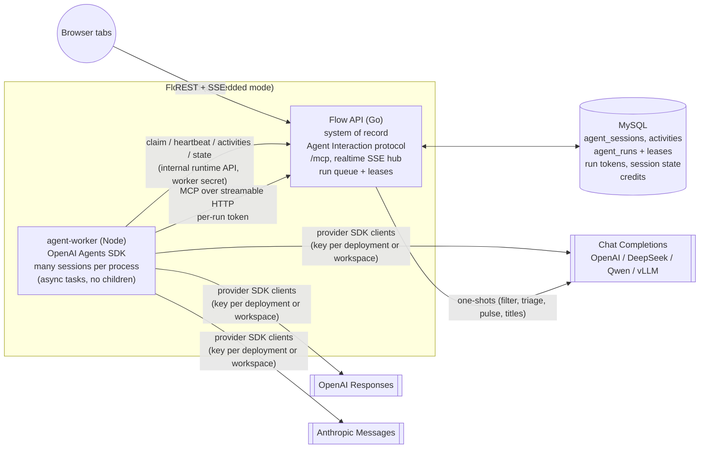
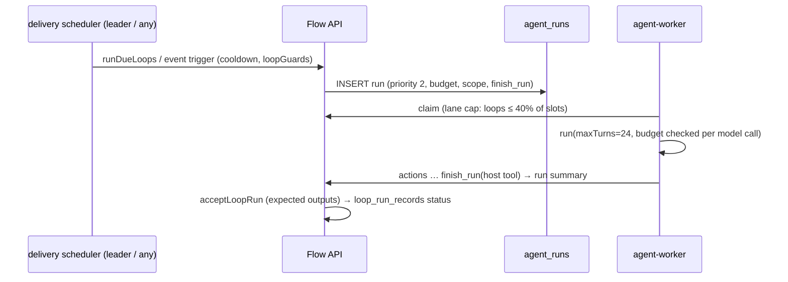
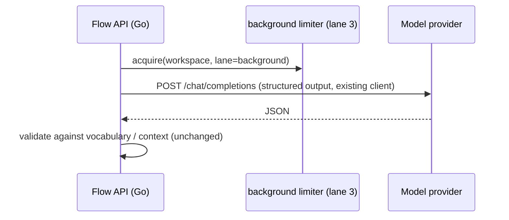

# Agent runtime v2: an OpenAI Agents SDK worker talking to providers directly

Status: design + spike, 2026-10-13. Owner: agent platform. Spike code: [`agent-worker/`](../agent-worker). Phase 0 (queue, run tokens, internal runtime API) is in `main`. Chat replies run on the worker behind `FLOW_AGENT_RUNTIME=worker` (§6.8, 2026-10-27).

## 中文摘要

- **决定**：把 Flow 的 agent 核心从 Go API 进程内的手写工具循环（`agent_stream.go` 的 `runAgentSession`）拆成独立的 **agent worker 运行时**。worker 用 **OpenAI Agents SDK**（TypeScript，`@openai/agents` 0.20，MIT）作为 harness，**直接**调用模型提供方，不再需要协议转换网关：
  - OpenAI **Responses**（`OpenAIResponsesModel`）；
  - OpenAI **Chat Completions**（`OpenAIChatCompletionsModel`，自定义 `baseURL`，覆盖 DeepSeek、Qwen、vLLM 等兼容服务）；
  - **Anthropic Messages**（`aisdk()` + `@ai-sdk/anthropic`）。
- **Flow API 仍是唯一的数据源**：会话、activity、审批、change set 都在 Flow 里。worker 没有数据库凭据，只通过 `/mcp`（每个 run 一个短期 run token）和内部 runtime API（`/internal/agent-runtime/*`，已在 phase 0 上线）访问数据。
- **部署**：先做**嵌入式**——worker 是同一个 pod 里的 sidecar，队列用 MySQL 行租约（不需要 Redis，也不需要网关）。之后扩展成集群：Redis Streams 或 NATS 作队列，worker 按队列深度扩缩。
- **调度**：分优先级通道（chat > 评论线程/委派 > loops > 后台），加上每个 workspace 的并发配额、公平调度和 AI credit 计费。
- **Spike 结论**（数字见 [§16](#16-spike-results)，主模型 `deepseek-flash`，同一模型同时提供三种协议）：
  - **质量**：38 个用例（15 个核心 + 23 个改编自参考应用研究的用例）× 3 次重复。worker 三个协议的通过率为 100% / 99.1% / 100%（Responses / Chat / Anthropic），基线（进程内 Go agent）为 93.0%。
  - **基线的问题**：审批后续跑时不回传 DeepSeek 的 `reasoning_content`，导致 400；还有一次批量删除删错了对象（删的是其他测试的 issue）。
  - **延迟**：worker p50 为 8.8–9.4 s，基线为 12.1 s；首个 activity p50 为 1.3–1.9 s，基线为 2.4 s。
  - **并发**：单个 worker 进程（无子进程）跑 400 个并发会话（读、写、stop、挂起/恢复混合），成功 396–398/400；800 并发时 DeepSeek 连接错误激增到 1,622 次，成功率降到 86%。每会话内存约 **2.5–6 MB**（Claude Agent SDK spike 是 200–260 MB），CPU 约 0.1–0.2 s/会话，事件循环 p99 延迟 ≤ 76 ms。瓶颈是上游连接和 Flow API 的 `/mcp` 延迟（400 并发时 p99 4.7 s），不是 worker。
  - **基线负载**：进程内 agent 在 200 并发时成功 183/200，Go API 内存涨到 8.8 GB；另一次 200 并发 API 直接失去响应（0/200）。
  - **功能**：并行工具调用在三种协议上都没有丢参数；`ask_user` 和批量删除审批都通过 `needsApproval` + `RunState` 实现。挂起的 run 序列化成 JSON（10–17 KB），可以在另一个进程里恢复（恢复到首个 activity约 40 ms）。stop 在 1–8 ms 内生效，之后追问正常。kill -9 worker 后，Flow 的租约回收按预期工作：没写过数据的 run 重新排队并由另一个 worker 完成，写过数据的 run 标记为 interrupted。
- **必须修的问题**（前四项已修复）：
  - ✅ run token 在 `/mcp` 上曾被当成“未认证”请求，按 IP 限流（每小时 600 次，整个 sidecar 共享）。现在按 run（每小时 1,200 次）和 workspace（每小时 36,000 次，可按 workspace 配置）分别限流，API key 和会话不受影响。
  - ✅ Flow MCP 曾把参数校验错误作为 JSON-RPC 错误返回，原因只放在 `data.detail` 里。现在作为 `isError` 工具结果返回，原因写在文本里，模型能看到并自行修正。
  - ✅ stop 曾只能通过心跳（最长 15 s）送达 worker。现在每个 worker 有一个取消长轮询：同进程 1–2 ms 送达，跨进程约 0.5 s，心跳作为兜底。
  - ✅ 400 并发时 Go API 内存涨到 7.7 GB：每次工具调用都深拷贝一份 workspace 元数据（约 16 MB），且并发调用数没有上限。现在工具调用并发限制为每核 2 个，拷贝占用的内存上限约 0.3 GB（§16.7 第 10 条）。
  - SDK 不会自动保存中止或失败的 run 的输出，也不会重放已经开始流式输出的请求。worker 必须自己补全历史、自己重试（spike 已实现）。
- **建议**：
  - **Go**：Chat Completions 作为默认路径（覆盖面最广），Responses 用于 OpenAI，Anthropic Messages 用于 Claude。三者都已在实测中达标。
  - 许可是 MIT / Apache-2.0，不再有法务阻塞。

---

## 1. Goals and non-goals

### Goals

1. **Isolation.** Agent runs must never starve the Go API. Today a chat turn runs inside the HTTP request goroutine with a detached context, holds workspace mutation locks while persisting, and there is no global cap on concurrent chat runs (`agentRuns` is just a `sync.Map`).
2. **One runtime for every agent surface.** This covers in-app chat, comment threads and delegation, loops, and agent-initiated sessions. Every surface speaks Flow's Agent Interaction protocol (sessions, activities, signals), which already exists for application agents (`application_agents.go`, `agent_session_api.go`).
3. **Any model protocol, no gateway.** OpenAI Responses, OpenAI Chat Completions (and every compatible provider) and Anthropic Messages are adapters inside one open-source harness, so model choice is configuration rather than Go code. `agent_provider.go` currently hand-rolls 1,060 lines for three protocols.
4. **A better harness for free.** The OpenAI Agents SDK brings:
   - streaming events, `AbortSignal` stop, tool approvals (`needsApproval`) with serializable `RunState` interruptions;
   - an MCP client with per-turn tool filtering, sessions (pluggable history), runner-managed retries, per-call timeouts, `maxTurns`, guardrails, tracing hooks.
5. **Embedded first.** The default deployment must run as a sidecar next to the API with only MySQL (no Redis). It must grow to a cluster (Redis Streams/NATS, autoscaling) without a data-model change.
6. **Capacity.** Hundreds to thousands of concurrent *users*, with per-workspace fairness, model rate limits and AI-credit accounting.

### Non-goals

- Coding sessions (repo checkout, bash, file edits). The worker has no shell, file or web tools. Coding sessions are a separate, sandboxed product (`CodingAgentSettings`) and can reuse the queue later.
- Replacing Flow's MCP server or tool implementations. The tools stay in Go and keep their permission model.
- Changing the external application-agent API (webhooks, `/api/agent-tasks`). The built-in agent becomes one more consumer of it.
- One-shot features (AI filter, Triage Intelligence, Pulse summaries, chat titles) do not need an agent harness. They stay in Go on the existing provider client, behind a Go-side limiter (§9).

## 2. Today (baseline)

| Concern | Today | Problem at scale |
|---|---|---|
| Chat loop | `runAgentSession` in the request goroutine; 8 tool turns; reply persisted once at the end into the workspace JSON blob | No queue, no cap. A crash loses the reply. Persisting takes the workspace write lock. |
| Streaming | The per-request SSE goes only to the requesting tab. Other tabs get `agent.message_completed` from the realtime hub. | No fan-out of deltas; no reattach after reload. |
| Stop / approvals | `agentRuns`, `agentApprovals`, `agentElicitations` are process-local maps | Breaks with more than one API process unless routing is sticky. |
| Threads / delegation | `application_agent_tasks` plus activities in SQL, a 4-slot worker per process, CAS row claim, 5-minute lease | Good model. Reuse it. |
| Loops | `loop_run_records` with lease and heartbeat (60 s / 15 s); 2 per workspace, 4 per process | Reuse the lease pattern. |
| One-shots | Share the agent provider client, with no global semaphore (triage has 4 slots) | Unbounded model concurrency. |
| Providers | Three hand-written protocol clients. Reasoning is never replayed (DeepSeek thinking mode then rejects approval resumes, §16.4). Anthropic gets no `cache_control`. | Protocol drift; every new model feature is Go work. |

Detailed inventory: `scratchpad/agent-research/flow-agent-inventory.md` and §1–15 of the code survey behind this doc.

## 3. Architecture



### Responsibilities

**Flow API (Go)** owns everything durable:
- sessions, activities, signals;
- the run queue and leases, and the reconciler that recovers expired leases;
- run-token minting, the tool implementations (`/mcp`), approvals, change sets and attribution;
- suspended harness state (`agent_session_states`), credits and quotas;
- the realtime fan-out to browsers.

It renders the system prompt (workspace, team and personal guidance, skills, `promptContext`, referenced issues) into the run payload (`GET /internal/agent-runtime/runs/{id}/payload`), so the worker stays generic.

**agent-worker (TypeScript)** is stateless apart from in-flight runs. Per process it holds one model client per provider and a pool of session tasks. For each claimed run it:
1. mints the run token and opens a `MCPServerStreamableHttp` to Flow's `/mcp` (the only data tool source); host tools (`ask_user`, `load_tools`, later `finish_run`) run in-process;
2. runs the agent with the session's history and maps SDK stream events to activities (§5);
3. heartbeats the lease and honours stop (heartbeat `cancel`), approval and select signals;
4. serializes the `RunState` when the run waits for a person, and finishes the run with usage.

It has **no DB credentials** and no Flow secrets beyond the run token and its worker secret. It holds provider keys (§12–13).

**No gateway.** Protocol translation is the SDK's model adapters. Retries, timeouts and rate-limit backoff are the SDK runner's (`modelSettings.retry`, `timeoutMs`). Budgets and per-workspace limits are Flow's (credits ledger, lane caps). A gateway (LiteLLM, a cloud AI gateway) remains optional for operators who want central keys or spend logs, but nothing depends on it.

The **queue** is the MySQL/SQLite table `agent_runs` with CAS row leases (embedded mode, in `main`). In cluster mode, Redis Streams or NATS JetStream carry run ids and SQL stays the state of record.

### Why the built-in agent speaks the Agent Interaction protocol

Today, threads and delegation already store `AgentTask` plus `AgentActivity`. Chat uses a different model: `AgentSession.Messages` in the workspace blob.

v2 unifies them. Every conversation is an **agent session row** (generalising `application_agent_tasks` with `resource_type = chat | issue | project | document | loop`), and its history is the **activity log** plus the harness transcript (§6.4). The worker is "just another agent" that receives `created` and `prompted` events through the queue instead of a webhook.

This gives us:
- one stop, approval and select mechanism;
- one history source;
- one UI renderer, with streaming in threads and chat alike;
- external agents and the built-in agent behaving identically, as the AIG requires.

## 4. Data model (new and changed)

Phase 0 landed `agent_runs`, `agent_run_tokens`, `agent_run_changes`, `agent_run_keys` (idempotent activity posts) and `agent_session_states` (`api/internal/store/agent_runs.go`). Still to add:

```sql
-- generalises application_agent_tasks (keep the table; add columns), chat sessions move out of the workspace blob
ALTER TABLE application_agent_tasks
  ADD COLUMN kind VARCHAR(16) NOT NULL DEFAULT 'thread',   -- chat | thread | delegation | loop | background
  ADD COLUMN transcript_ref VARCHAR(128) NULL;             -- harness transcript key (§6.4)

CREATE TABLE agent_transcripts (           -- the SDK session (input items), append-only chunks
  workspace_key VARCHAR(64), session_id VARCHAR(64), seq BIGINT, items LONGBLOB, created_at BIGINT,
  PRIMARY KEY (workspace_key, session_id, seq));

CREATE TABLE agent_credit_ledger (workspace_key VARCHAR(64), run_id VARCHAR(64), model VARCHAR(64),
  input_tokens BIGINT, output_tokens BIGINT, cache_read_tokens BIGINT, cost_micros BIGINT, created_at BIGINT,
  PRIMARY KEY (workspace_key, run_id, model));
```

`application_agent_activities` stays the append-only log. Activities carry a client-supplied `activityId` (idempotent, phase 0) and an `ephemeral` flag.

## 5. Event mapping (SDK to Flow activities)

The worker iterates the `StreamedRunResult` and produces activities (`agent-worker/src/worker.ts`, `toActivities`).

| SDK event | Flow activity | Durable? | Today's chat SSE equivalent |
|---|---|---|---|
| run accepted (before any network call) | `thought` "Working…" (ack), session `active` | yes (AIG 10 s `unresponsive` rule) | `session.started` |
| `raw_model_stream_event` `output_text_delta` | `text.delta` | **no**: realtime hub only, coalesced every 100 ms | `text.delta` |
| raw `response.reasoning_summary_text.delta` (Responses), `reasoning_content` (DeepSeek Chat), `reasoning-delta` (AI SDK) | `thought` | ephemeral | `reasoning.delta` (dropped today) |
| raw `ask_user` argument deltas (Responses `function_call_arguments.delta`, Chat `tool_calls[].function.arguments`, AI SDK `tool-input-delta`) | running `question` part: the `question` string read from the partial JSON, under the call id the final elicitation reuses (as `agent_stream.go` since 9d62921) | ephemeral | `tool.delta` → running question part |
| `run_item_stream_event` `tool_called` | `action {action, parameter}` | yes | `tool.started` |
| `tool_output` (+ `customData.isError`, `customData.change` from the MCP result) | `action {…, result}` (update in place) plus a change-set card | yes | `tool.completed` |
| run ends with `interruptions` (an approval) | `elicitation` + `select` signal [Approve, Reject] | yes, status `awaitingInput` | question part with `approval` |
| run ends with an `ask_user` interruption | `elicitation` + `select` signal with the options | yes, status `awaitingInput` | question part |
| `finalOutput` | `response` (final markdown) plus usage on the run | yes, status `complete` | `session.completed` |
| thrown error / `MaxTurnsExceededError` | `error` | yes | `error` |
| abort after a stop signal | `response` "Stopped" (AIG: halt, then respond) | yes, status `canceled` | `error` "Generation stopped" |

**Fan-out.** The worker posts activities to `POST /internal/agent-runtime/runs/{id}/activities` (phase 0, idempotent by `activityId`). Ephemeral events go straight to `publishRealtime`, using the per-workspace replay ring, so every tab sees the deltas and a reloaded tab reattaches with `Last-Event-ID`. In cluster mode, cross-instance delivery already uses Redis pub/sub (`startCoordination`).

## 6. How existing features map

### 6.1 Tools: Flow MCP over HTTP with per-run scoped tokens

- **Tool source.** One `MCPServerStreamableHttp` per session: `url: <api>/mcp`, `Authorization: Bearer <run token>`, `cacheToolsList: true` (one `tools/list` per connection). The agent has no other tools than Flow's and the host tools; there is no shell, file or web tool to disable.
- **Run token (phase 0).** `POST /internal/agent-runtime/runs/{id}/token` returns a `flowrun_…` token (15 min TTL, revoked when the run ends) acting as the run's principal: the user (chat) or the built-in app on behalf of the user (threads), intersected with the principal's teams and a tool allowlist. A write through the token sets `agent_runs.wrote` (used by lease recovery, §11). Verified in the spike: claim → token → MCP → complete, and recovery after a killed worker (§16.6).
  - **Fix needed:** `/mcp` rate-limits `flowrun_` tokens as *unauthenticated* traffic keyed by client IP (`subjectForPublicRequest` only knows `flow_api_`/`flow_oauth_`): 600 requests/hour shared by every run of a sidecar. Bucket run tokens per workspace in a dedicated `agentRun` category.
- **Attribution.** `/mcp` stamps `User.Via` from the token's principal, so history reads "Flow … on behalf of X" with no worker involvement.
- **Tool economy.** Flow's MCP serves 90 tools (~97 KB of schemas). The worker offers the chat core set (24 tools) plus the groups picked from the request, and `load_tools` adds groups mid-run. This is the SDK's callable `toolFilter`, evaluated on every model turn against the run context (`loadedGroups`); the tool list itself is cached per connection. Measured: about 41 tools per call and 19–20k prompt tokens per call on `deepseek-flash`, 86–87% of them cache reads on the OpenAI protocols (§16.2).
- **Tool errors reach the model.** The SDK's default MCP error text hides the cause; the worker's `errorFunction` passes the message and Flow's `data.detail` ("unexpected additional properties [\"teamId\"]"), and the model corrects the call. Flow should return argument-validation failures as tool results with `isError` (MCP spec) instead of JSON-RPC `-32602`.

### 6.2 Approvals: `needsApproval`, `RunState` and the policy port

`agent-worker/src/policy.ts` ports `agent_approval_policy.go` and `agentToolNeedsApproval`:
- `external_*` connector tools ask only when their connector is set to always ask (`toolApproval: "always"`), whatever the tool's annotations; the run context lists those tools (`alwaysAskTools`). Until `/mcp` passes a connector's setting to the worker, the list is empty and nothing asks;
- every Flow write runs at once: deletes (one item or many) and status updates the agent wrote itself included. Approvals for bulk deletes and agent-written updates that earlier versions saved still render and still run or drop their held calls when answered, but none are created.

The SDK has no approval hook for MCP tools, so the worker's `Agent` subclass sets `needsApproval` on the converted MCP function tools (`getMcpTools`). The held calls of one model turn become **one** elicitation (§16.5).

Approval is driven only by real tool calls. A model that writes the approval question as its answer ("Allow <connector>: <tool>?") instead of calling the tool is retried once with a note to call the tool; a second such answer ends the run in error rather than completing it. Later runs replay an answered approval as the person's decision ("Approved: …" / "Rejected: …"), never as the agent's own words.

Every approval and `ask_user` uses the same path. The run ends with `interruptions`; the worker stores `result.state.toString()` (10–17 KB, context included) in `agent_session_states` and releases the slot. When the person answers, Flow enqueues a `resume` run; any worker loads the state with `RunState.fromString`, calls `approve`/`reject` (with a rejection message for the model) and runs it again. Held calls then execute exactly once, through the SDK, with their original call ids. There is no short-wait mode holding a lease: suspension costs about 40 ms to restore (§16.5), so every wait suspends.

### 6.3 `ask_user`

`ask_user` is a host function tool with `needsApproval: true` and the schema of `agent_ask_user.go`. The interruption carries the question and options; the answer is stored in the run context (`answers[callId]`) and the item approved, so the tool returns `{answer}` to the model. A clicked option arrives as its value; free text is passed through.

### 6.4 History and compaction

- **Primary history.** An SDK `Session` per agent session holds the input items (messages, function calls and results, reasoning items). The spike stores it as JSONL files (`FileSessionStore`); production implements the same interface over `agent_transcripts` through the internal runtime API, so any worker continues any conversation. Reasoning items are replayed as each protocol requires (Responses encrypted reasoning, DeepSeek `reasoning_content`, Anthropic thinking blocks), which fixes the baseline's approval-resume failure on thinking models.
- **Repair on stop and failure.** The SDK keeps only the user's message of an aborted or failed run. The worker appends the items the run produced (calls that ran, their results) and closes calls without results with a "stopped before a result came back" output, so the next prompt neither fails with "No tool output found" nor denies writes that happened (§16.5).
- **Compaction.** A `callModelInputFilter` runs before every model call: tool results from earlier requests over 6,000 characters are cut to a head plus a note, and above 60% of the declared context window whole earlier requests are dropped, oldest first, keeping call/result pairs. The stored history stays complete. A model-written summary turn can replace the drop step later. Declare the real context window per model in worker settings.

### 6.5 Streaming and stop

- **Streaming.** See §5. Text deltas never touch SQL.
- **Stop.** `POST /api/agent/sessions/{id}/stop` (chat) or a `stop` signal (threads) sets `agent_runs.cancel_requested`. The worker learns it from the next heartbeat (≤ 15 s today; a 1 s heartbeat or long-poll control channel for P0 runs is needed for chat) or, in cluster mode, a control subject. It then aborts the run's `AbortController`: model stream and in-flight MCP calls stop in **1–8 ms** (§16.5). Calls already received by `/mcp` complete server-side and are recorded.

### 6.6 Undo and change sets

Phase 0 records changes in `/mcp` when the call carries a run token: `before`/`after` per `(run_id, seq)` in `agent_run_changes`, listed by `GET /internal/agent-runtime/runs/{id}/changes`, and `structuredContent.change` on the tool result. The worker copies it into the `action` activity (`customDataExtractor`). Undo and restore keep their current semantics; `agentChangeLocks` become a row lock.

### 6.7 Comment threads, delegation and loops

- **Threads and delegation.** Mention or delegation creates the task (unchanged). Instead of `executeBuiltinApplication` in-process, Flow enqueues an `agent_runs` row (priority 1). The payload's `context` already carries the rendered thread prompt (phase 0). On delegation, AIG behaviour is: move the issue to the first started state, then ack within 10 s.
- **Loops.** A loop run is an `agent_runs` row (priority 2) with the loop's instructions and scope; `finish_run` is a host tool; `maxTurns` = `FLOW_LOOP_MAX_TURNS`; the run lease timeout = `FLOW_LOOP_RUN_TIMEOUT`; budget is enforced from usage per model call (the runner's `Usage`) against the loop's credit budget. `loopScope` stays in `/mcp` through the token.
- **External MCP connectors (`external_*`).** Stay proxied by Flow, which holds the credentials; exposed through `/mcp` to the run token only when allowed. Calls follow the connector approval rule in §6.2.
- **Web search.** Expose Flow's `web_search` and `fetch_url` (SSRF-safe) through `/mcp` when `agentWebSearch` is on. Provider-hosted web search (Responses `web_search`) is possible per model but bypasses Flow's controls.

### 6.8 Chat replies on the worker: persistence — in `main` behind `FLOW_AGENT_RUNTIME=worker`

Status: implemented 2026-10-27 (`api/cmd/server/agent_worker_chat.go`, `agent-worker/src/chat-run.ts`); the default stays in-process. Chat sessions stay in the workspace record (phase 4's session rows are not started): the worker run writes the same streaming chat message the in-process reply saves (`agent_live_reply.go`), so the `agent.message_*` realtime events, a reloaded page and the reply-follow hook work unchanged.

- **Queue.** A chat message renders the prompt as the in-process reply does (`buildAgentChatPrompt`, in the owner's request: system prompt, the conversation with the latest replies' tool calls and results), saves an empty streaming reply (`agent_message_<runId>`), and queues a chat run (principal mode user, the owner). The payload names the reply and the tool budget; the rendered prompt is kept with the run (`agent_run_keys` `chat:context`) and served by `GET …/payload`. The worker runs from that conversation (an in-memory session), not from its own history. The asking request follows the reply: the SSE route relays events while the worker's posts reach this API process (and re-reads the saved reply every second otherwise); the JSON route returns the finished session.
- **Activities.** `POST …/runs/{id}/activities` takes, for a chat run, `text.delta` (coalesced every 100 ms by the worker), `question.delta`, `action`, `action.result` (with the `/mcp` change ref, turned into the part's change card), `elicitation`, `response` and `error`. Flow keeps the reply's parts in the API process (rebuilt from the saved reply when another process wrote it) and saves part boundaries at once, text at most once a second. Narration before a tool call becomes a step, as in-process. Connector questions (MCP elicitation) are attached by the API process holding them.
- **Waiting.** `ask_user` ends the reply with its question; the answer is the next message (a new run). Calls of a connector set to always ask wait on the reply, each with its own approval id; the worker stores the `RunState` in `agent_session_states` and finishes the run `awaiting`. Once every held call is answered (`POST …/approvals/{id}`, before or after the run suspended), Flow queues a resume run with the decisions per call id; it continues the same reply and inherits the ledger and tool budget.
- **Stop.** `POST …/stop` cancels the reply's run: a queued or awaiting run at once (the reply is saved as stopped), a held run through the cancel long-poll (the worker ends the reply as stopped). A connector question waiting in the run's call is cancelled too (here, or by a 1 s re-check from another process).
- **Budget and outcomes.** `/mcp` applies the reply's tool-call budget and failed-repeat rule to a chat run's calls; the run guard in chat mode ends tool turns at the turn budget (`withhold`, plus the nudge), answers an ungrounded outcome claim with the nudge once and then Flow's statement, and appends the ledger's count (§16.7; `agent_run_outcomes.go`). A reply the budget stopped ends with the budget notice.
- **Failure.** A dead worker's run is requeued with the reply reset (nothing written) or interrupted by the reconciler (`agentReplyInterrupted` row with Retry). A worker reply lives as long as its run (queued, held or awaiting); one whose run ended without saving it is interrupted (or saved as stopped) by the live-reply sweeper a minute later.
- **Limits (2026-10-28).** A queued run (a new reply or a resume) that no worker claims within `FLOW_AGENT_WORKER_CLAIM_TIMEOUT` (default 2 minutes) is cancelled (`CancelUnclaimedAgentRun`, only while still queued) and the reply ends with "No agent worker is available; try again or contact your admin"; the asking request checks every 5 s once the timeout could have passed, the live-reply sweeper once a minute. Held calls of a run awaiting for 30 minutes (`agentApprovalTimeout`, the in-process approval timeout; measured from the run's suspension) are rejected and a resume run continues the reply, as the in-process reply goes on after a timed-out approval. The turn budget is the reply's: the chat budget state counts the model turns of every run (`turns`), and a resume's payload carries `turnsBefore`, which the guard adds to the worker's per-run round.
- **Not on the worker yet:** loop builder conversations (their question tool and drafts), chats with sent files (read in-process), approvals saved by earlier versions; threads, delegation and loops (phases 2–3). Provider-hosted web search and the in-process chat's per-request tool subset (the worker uses its own tool groups) differ.

## 7. Sequence diagrams

### 7.1 Chat turn

```mermaid
sequenceDiagram
  participant B as Browser
  participant A as Flow API
  participant Q as agent_runs (SQL)
  participant W as agent-worker
  participant P as Model provider
  B->>A: POST /api/agent/sessions/{id}/messages {message}
  A->>A: append prompt activity (session pending)
  A->>Q: INSERT run (priority 0, payload)
  A-->>B: 202 {sessionId, runId}  (UI listens on workspace SSE)
  W->>A: POST /internal/agent-runtime/claim {free, waitMs}
  A->>Q: CAS lease (queued→leased, lease 60 s)
  A-->>W: runs
  W->>A: POST …/runs/{id}/token, GET …/payload (system prompt, messages)
  W->>A: thought "Working…" (ack ≤ 1 s)
  W->>P: stream (Responses / Chat / Messages), tools = core + groups
  P-->>W: deltas, function calls (parallel)
  W->>A: activities (ephemeral deltas → publishRealtime → all tabs)
  W->>A: MCP tools/call save_issue (Bearer run token)
  A-->>W: result + structuredContent.change
  W->>A: action activity (durable)
  W->>A: response activity; POST …/complete {status: done, usage} → credits; token revoked
```

### 7.2 Comment thread or delegation


### 7.3 Loop run



### 7.4 Triage, AI filter and other one-shots (no harness)



### 7.5 Ask user, approvals and resume

```mermaid
sequenceDiagram
  participant W1 as worker (process 1)
  participant A as Flow API
  participant U as User
  participant W2 as worker (process 2)
  W1->>W1: model turn: external_… (connector set to always ask) → needsApproval
  W1->>A: PUT …/state (RunState JSON, ~12 KB); elicitation {Approve/Reject, preview}
  W1->>A: complete {status: awaiting}  (slot released)
  U->>A: select "approve" (hours later)
  A->>A: enqueue resume run
  W2->>A: claim, GET …/state
  W2->>W2: RunState.fromString → approve(item) → run (held call runs once) → response
```

### 7.6 Undo

```mermaid
sequenceDiagram
  participant U as User
  participant A as Flow API
  U->>A: POST /api/agent/sessions/{id}/changes/{changeId}/undo
  A->>A: lock change row; revert fields still equal to "after"; skip edited fields
  A-->>U: change state=undone (card shows Restore)
```

## 8. Queue design

### 8.1 Embedded mode: SQL row leases (no Redis) — in `main`

- Workers never touch SQL. They call `POST /internal/agent-runtime/claim {free: {chat, thread, loop, background}, waitMs}` with the worker secret and `Flow-Worker-Id`; the Go API claims with the portable CAS pattern of `ClaimApplicationTask`, honouring `FLOW_AGENT_WORKSPACE_RUN_CONCURRENCY` (default 4).
- Heartbeat every 15 s extends the 60 s lease; the response carries `cancel` (cancel requested, or the session was stopped).
- Stops are pushed: each worker keeps one long-poll open, `POST /internal/agent-runtime/cancels {waitMs ≤ 25 000, ignore: [runIds already stopping]}`, answered `{cancel: [runIds]}` as soon as a run it holds is cancelled or its session is stopped (an in-process wake; it also re-checks SQL every second for stops recorded by another API process). The worker's `CancelWatcher` (`runtime-client.ts`) calls `session.stop()`; the heartbeat's `cancel` stays the fallback. Measured: 1–2 ms from the stop to the answer in-process, 0.5 s across processes (§16.6).
- A reconciler runs every 30 s. Expired leases go back to `queued` if nothing was written (`wrote=0`, attempts < 2); otherwise the run is `interrupted` and an `error` activity tells the person (no silent repeat of writes). Measured: a killed worker's read-only run was requeued and finished by another worker 54 s after the kill; a run that had written was interrupted (§16.6).
- Wake-up: `INSERT` calls a local `kick()`; the claim long-polls up to 20 s, so idle CPU is near zero and pickup latency is under 50 ms.
- The spike's `queue-worker.ts` implements the worker side (claim loop, token, heartbeat with cancel, complete).

### 8.2 Cluster mode: Redis Streams or NATS

SQL stays the source of truth (status, lease, attempts). The stream carries only `{runId, workspace, priority}`:
- **Redis Streams.** One stream per lane (`agent:runs:p0…p3`) with consumer group `workers`, `XREADGROUP` by lane weights, `XAUTOCLAIM` for dead consumers, and `XACK` on terminal status.
- **NATS JetStream.** A WorkQueue stream with subjects `agent.runs.p{n}.{workspace}`, `MaxAckPending` per consumer for back-pressure, and `AckWait` equal to the lease.

The claim still does the SQL CAS, which keeps it idempotent if the stream redelivers. Control messages (cancel, signals) move to pub/sub (`agent.ctl.{runId}`).

## 9. Scheduling and fairness

| Lane | Work | SLO | Default share of a worker's slots |
|---|---|---|---|
| P0 chat | user waiting on the screen | pickup < 200 ms, first activity < 1.5 s | may use 100% |
| P1 threads / delegation | AIG: ack within 10 s | pickup < 2 s | ≤ 75% |
| P2 loops | scheduled or event | minutes | ≤ 40% |
| P3 background | triage, pulse, titles (one-shots, Go-side limiter) | best effort | ≤ 20% |

- **Caps are ceilings, not reservations**, so idle capacity is used. A P0 run never waits behind P2 or P3, because P2 and P3 can't hold more than their caps. When P0 is saturated, P2 runs are pushed back (`next_attempt_at += jitter`) rather than preempted.
- **Per-workspace quotas.** Default limits:

  | Scope | Limit |
  |---|---|
  | Workspace | ≤ 8 concurrent runs (phase 0 default 4) |
  | User (chat) | ≤ 3 concurrent runs |
  | Loops | ≤ 2 concurrent (today's default) |
  | Queue | 200 queued runs per workspace |

  Fairness uses deficit round-robin across workspaces within a lane. When over quota, the run stays queued and the UI says "Waiting for capacity…" through an ephemeral thought.
- **Global model rate limiting.** Per provider deployment: a token bucket per lane in Flow (existing `TakeTokens` in Redis mode, in-memory otherwise) gates claims. Inside a run, the SDK runner retries 408/429/5xx and network errors before the first streamed event (`retryAfter` honoured, jittered backoff, 2 retries), and the worker retries a run once when the stream drops mid-way and nothing was written (§11). Provider SDK retries are off so retries are not doubled.
- **AI credits.**
  - Preflight: a run is claimable only if the workspace balance is above zero.
  - Per model call: usage (`inputTokens`, cached, output) is known at `response_done`; the worker stops a run that exceeds its budget and reports usage on `complete` for `agent_credit_ledger`.

## 10. Worker process model

- **In-process sessions.** A session is an async task in one Node process: an `Agent`, one MCP connection, the run's AbortController, and buffers. There are no child processes. Measured in one process on a 10-core M-series machine (§16.3):

  | Concurrent sessions | Peak RSS | Per session | CPU (mean, % of one core) | Event-loop lag p99 |
  |---|---|---|---|---|
  | 20 | 277 MB | 6 MB | 7% | 14 ms |
  | 100 | 515–748 MB | 3.6–6 MB | 13–28% | 13–38 ms |
  | 200 | 710–977 MB | 2.8–4.1 MB | 19–29% | 15–76 ms |
  | 400 | 1.0–1.3 GB | 2.2–2.8 MB | 38–40% | 26–109 ms |
  | 800 | 2.2 GB | 2.5 MB | 31% | 20 ms (provider connection errors: 686/800 ok) |

  A worker's concurrency is therefore **bound by the provider and by Flow's `/mcp`**, not by memory: about 150 MB base plus 3–6 MB per active session, and 0.1–0.2 CPU-seconds per session. Keep one process per core and cap slots per process at about 200–400 (event-loop p99 stays under 100 ms; single GC pauses reach 0.5–0.9 s).
- **Slots.**

  | Mode | Defaults |
  |---|---|
  | Embedded sidecar | 1 process, 1 GiB, 100 slots (P0 may use 100, P1 75, P2 40, P3 20); bounded in practice by `FLOW_AGENT_WORKSPACE_RUN_CONCURRENCY` and provider limits |
  | Cluster | 2-CPU / 2 GiB workers with 2 processes × 200 slots, autoscaled on queue depth |

- **Lifecycle.** A session object lives for one run; history and suspended state are outside the process, so a follow-up can run anywhere. Waiting for a person always suspends (serialize, release the slot). The MCP connection is opened per run (a `tools/list` per run, 20–60 ms).
- **No pre-warming needed.** Creating a session is microseconds; the first activity is the ack posted before any network call, and the first model-driven activity came at p50 1.3–1.9 s in the eval.
- **Sandboxing.**
  - No shell, file or network tools; the only tool sources are `/mcp` (run token) and host tools.
  - Tracing to OpenAI is disabled (`setTracingDisabled(true)`); the worker exports its own OTel spans.
  - The container runs as non-root on a read-only rootfs, with a NetworkPolicy allowing egress only to the API (loopback in a sidecar) and the configured provider hosts.
  - SDK versions are pinned (exact versions plus the lockfile) and upgraded deliberately with the eval as the gate.

## 11. Failure handling

| Failure | Behaviour |
|---|---|
| Worker crash or OOM | The lease expires (60 s). The reconciler requeues the run if `wrote=0` and attempts < 2 (another worker restarts it from the stored history), else marks it `interrupted` with an `error` activity "Execution was interrupted — Retry?". Verified with `kill -9` (§16.6). |
| Model call fails before streaming (network, 408/429/5xx) | SDK runner retries twice with jittered backoff, honouring `retry-after`. At 400 sessions, 127 connection errors were all absorbed this way. |
| Stream drops mid-response | The SDK never replays a stream that emitted events. The worker reruns the request once from stored history when no write ran; otherwise it keeps what ran in history and reports the error. |
| Model call hangs | `timeoutMs` (240 s) per model call; then the rules above. Without it, a stalled provider held runs for 17–32 minutes in the gpt run. |
| Tool argument errors | Flow returns schema failures as `isError` tool results whose text is the reason ("Invalid arguments for list_issues: … enum: identifier does not equal any of …"), so the model corrects (0.4 per case in the eval, nearly all `fields` enum misses on list tools). Malformed JSON-RPC and unknown tools stay protocol errors. |
| Max turns | `MaxTurnsExceededError` → `error` activity. Seen on 1 of 200 read sessions under load (paging loops); keep `maxTurns` at 24 for chat. |
| Duplicate delivery | The claim CAS makes it a no-op; activities are idempotent by `activityId`; write tools accept `Idempotency-Key: <runId>:<callId>` (phase 0 `agent_run_keys`). |
| Stale or unresponsive sessions | `firstActivityAt` comes from the ack thought posted before any network call. |
| Approval or ask timeout | Runs are suspended, not waiting; suspended sessions follow existing stale rules. |
| Flow API restart (embedded) | Runs in flight fail their next MCP call or heartbeat; the worker posts the error and the run is retried by the reconciler if nothing was written. |

## 12. Provider configuration

No gateway: each worker deployment configures model aliases directly.

```yaml
# agent-worker models (env or config file; keys from secrets)
models:
  flow-default:            # Chat Completions, any compatible provider
    protocol: openai-chat
    baseURL: https://api.deepseek.com          # or https://api.openai.com/v1, a vLLM/Ollama/Qwen endpoint …
    model: deepseek-flash
    apiKeyFile: /run/secrets/deepseek
    contextWindow: 128000
  flow-openai:
    protocol: openai-responses                 # store: false + encrypted reasoning; prompt_cache_key per session
    baseURL: https://api.openai.com/v1
    model: gpt-6.1-sol
    reasoningEffort: medium
  flow-claude:
    protocol: anthropic                        # aisdk(@ai-sdk/anthropic): adaptive thinking, effort, cache_control
    baseURL: https://api.anthropic.com/v1
    model: claude-sonnet-5
lanes: { chat: flow-default, thread: flow-default, loop: flow-default }
```

- **Per call:** `parallelToolCalls: true`; reasoning effort when configured; `prompt_cache_key` = session id (OpenAI protocols); automatic `cache_control` (Anthropic); `retry` (2, jittered, `retry-after`); `timeoutMs` 240 s.
- **Spike env** (`agent-worker/src/config.ts`): `FLOW_WORKER_PROTOCOL`, `FLOW_WORKER_MODEL`, `FLOW_WORKER_{RESPONSES,CHAT,ANTHROPIC}_BASE_URL` or `FLOW_WORKER_BASE_URL`, `FLOW_WORKER_API_KEY[_FILE]`, `FLOW_WORKER_REASONING_EFFORT`, `FLOW_WORKER_CONTEXT_WINDOW`.
- **Keys.** Provider keys live in the worker's secret store, never in run payloads or the browser. Per-workspace keys (bring your own key) are a payload reference to a secret, resolved by the worker. Spend is tracked in Flow from per-call usage.
- **Compatibility gate.** Each alias must pass the eval (§16) including the parallel tool-call and resume checks before it is enabled; providers differ in reasoning replay (DeepSeek requires `reasoning_content` back) and prompt caching.

## 13. Security

- **No DB credentials in workers.** All state changes go through the internal runtime API (worker secret: loopback-only in a sidecar, mTLS in a cluster) and `/mcp` (run token).
- **Scoped, short-lived run tokens.** Limited to the principal's access, the session's teams and the run kind's tool allowlist; expires with the run (15 min, re-minted for longer runs) and is revoked on completion.
- **Prompt injection.**
  - Content from issues, comments, documents and connector results is untrusted. The system prompt says so, and `promptContext` is XML-escaped.
  - The blast radius is bounded by the token scope.
  - Flow writes run without approval (deletes go to the trash and can be restored); a connector set to always ask holds its calls for approval (policy port). The baseline's wrong-target bulk delete (§16.4) is why writes to an issue the conversation never showed are refused (`agentUngroundedIssueTarget`).
  - There is no shell, file or web egress. `fetch_url` and `web_search` are opt-in and SSRF-safe.
  - The model cannot change its own permissions: `needsApproval`, the tool filter and the token are host-side.
- **Provider keys.** Only the worker holds them; one-shots in Go keep using the API's existing key.
- **Telemetry.** SDK tracing export is disabled; nothing leaves the pod except provider calls and Flow API calls.

## 14. Observability

- **Traces (OTel).** Worker spans: `run.claim`, `model.call` (from the model wrapper: start, first event, end, tokens, tools offered), `tool.call` (`action` to `result`), `approval.suspend`/`resume`, `run.finish`; attributes: workspace, run kind and lane, model alias. `/mcp` calls carry `X-Flow-Agent-Run` so Go spans link to the run. (The SDK's own tracing processor can feed the same exporter.)
- **Metrics.**

  | Area | Metrics |
  |---|---|
  | Queue | depth and wait time per lane and workspace |
  | Runs | duration, time to first activity / first text, outcome, retries |
  | Usage | tokens (cached share) and cost per workspace and model |
  | Provider | failed attempts by cause (429, 5xx, network, timeout), retry-after |
  | Workers | RSS, heap, event-loop lag, sessions in flight |
  | Flow API | `/mcp` latency p95/p99 by tool, CPU |
  | Recovery | lease expiries, requeues, interruptions |

- **Logs.** Per-run JSONL of activities (the spike's log format), errors with the provider request id.

## 15. Deployment modes and capacity

| | Embedded (default) | Cluster |
|---|---|---|
| Processes | `flow-api` plus a `flow-agent-worker` sidecar (same pod or compose project) | API Deployment; worker Deployment (HPA/KEDA on queue depth) |
| Queue | SQL `agent_runs` with CAS leases, long-poll claim | Redis Streams or NATS JetStream for run ids; SQL for state |
| Provider access | direct, keys in the sidecar | direct, keys in the worker Deployment (optional central gateway) |
| Cancel and signals | cancel long-poll per worker (heartbeat as fallback) | pub/sub control subject |
| Scale | ~100 concurrent runs per pod (1 GiB, 1 CPU) | ~400 per 2-CPU / 2 GiB worker × N |

**Capacity method.** Concurrency is driven by *active runs*, not users:

```
active_runs ≈ users_online × prompts_per_user_per_min × avg_run_seconds / 60 + loop_runs_in_flight
worker_slots = active_runs × (1 + headroom 0.3)
memory = workers × 150 MB + worker_slots × 5 MB
cpu    = runs_per_second × 0.15 CPU-s   (+ event-loop headroom: ≤ 200 slots per process)
model_rpm = runs_per_minute × model_calls_per_run (3.7)
prompt_tokens/min ≈ model_rpm × 20k (≈ 85% cached on OpenAI-protocol providers)
mcp_rps ≈ runs_per_second × (tool calls per run 5.5 + 3 per connection)
```

**Worked example** (eval and load numbers, §16; `deepseek-flash`; mean run 13 s):

| Scenario | Active runs | Slots (+30%) | Worker memory / CPU | Model RPM | Prompt tokens/min | `/mcp` rps |
|---|---|---|---|---|---|---|
| 200 users online, 10% chatting, 1 prompt / 2 min each; plus 5 loop or thread runs | ~4 + 5 = 9 | 12 | 1 sidecar, ~0.2 GB, < 0.1 CPU | ~40 | ~0.8M | ~1 |
| 1,000 online, 10% chatting; plus 20 background runs | ~22 + 20 = 42 | 55 | 1 sidecar, ~0.45 GB, ~0.2 CPU | ~190 | ~3.8M | ~4 |
| 5,000 online | ~110 + 60 = 170 | 220 | 1–2 cluster workers, ~1.3 GB, ~0.8 CPU | ~800 | ~16M | ~18 |
| Load-test ceiling (one process) | 400 (800 with provider errors) | – | 1.0–1.3 GB, 0.4 CPU | – | – | ~18 at p95 0.6–1.4 s |

**Load on the Go API.** At 100–200 concurrent worker sessions the lab API (SQLite) stayed at 0.4–0.8 GB and 2–3.4 cores peak, `/mcp` p95 56–563 ms. At 400 sessions `/mcp` p95/p99 reached 1.4 s / 4.7 s, and in one of two 400-session runs the API grew to 7.7 GB RSS (0.9 GB in the other). Cause and fix: every tool call deep-copies the workspace metadata (about 16 MB on the dev database) and nothing bounded the calls in flight; Flow tool calls are now limited to 2 per CPU (§16.3). For comparison, today's in-process agent at 200 concurrent chats drove the same API to 8.8 GB and 5.8 cores (183/200 ok), and in another 200-chat run the API stopped answering (0/200). The binding constraints are the provider (connection errors: 1 at 20 sessions, 48–127 at 400, 1,622 at 800) and Flow's tool latency, not the worker. MySQL/Postgres and the `/mcp` hot paths (list tools) need their own load test.

## 16. Spike results

### 16.1 Setup

- **Worker:** [`agent-worker/`](../agent-worker), TypeScript on Node 24.7, `@openai/agents` 0.20.0 (MIT), `@openai/agents-extensions` 0.20.0, `@ai-sdk/anthropic` 4.0.79 and `ai` 7.0.138 (Apache-2.0), `openai` 7.32.0, `@modelcontextprotocol/client` 2.3.1. About 60 MB of production dependencies, no native binary.

  | File | Contents |
  |---|---|
  | `src/models.ts` | model factory (3 protocols), per-protocol settings, retries/timeouts, the observing model wrapper |
  | `src/worker.ts` | `FlowAgentWorker` / `FlowAgentSession`: run, stream → activities, suspend/resume, stop, history repair, transient retry |
  | `src/flow-mcp.ts` | `MCPServerStreamableHttp` to `/mcp`: per-turn tool filter, error detail, change-set custom data, array-`structuredContent` shim |
  | `src/policy.ts`, `src/context.ts` | approval policy port and the serializable run context |
  | `src/host-tools.ts`, `src/question-stream.ts` | `ask_user` (approval interruption) and its streamed question, `load_tools` |
  | `src/tool-groups.ts` | chat core tools and groups (generated from `agent_chat_tools.go`) |
  | `src/session-store.ts`, `src/history.ts` | file-backed sessions and suspended runs; compaction filter |
  | `src/runtime-client.ts`, `src/queue-worker.ts` | phase-0 internal runtime API client and the claim/heartbeat/complete loop |
  | `src/eval.ts`, `src/report.ts` | 38-prompt eval (4 arms) and its tables |
  | `src/load.ts`, `src/concurrency.ts`, `src/long.ts`, `src/checks.ts` | load step-up, concurrency, long conversation, targeted checks |
  | `test/*.test.ts` | Anthropic and Chat Completions against mocked providers; policy; compaction; question streaming; cancel watcher (12 tests) |

- **Model:** `deepseek-flash`, one provider serving all three protocols (`https://api.deepseek.com` Chat Completions and Responses, `/anthropic` Messages), no reasoning effort set (provider default thinking). A first round on `gpt-6.1-sol` (Responses upstream, effort medium) is kept as a secondary table (§16.2).
- **Baseline:** today's in-process agent through `POST /api/agent/sessions/stream` with `FLOW_AGENT_PROTOCOL=openai-chat-completions`, the same model.
- **Flow:** a lab API on `:8090` (copy of the dev database, rate limiting off for load, worker secret set) so load and crash tests did not disturb the shared `:8080`; MCP authenticated with a personal API key (read/write) created for the dev user and revoked afterwards, or with run tokens in the queue tests.
- **Eval:** 38 prompts × 3 repeats × 4 arms (456 cases), each arm-repeat on its own "QA spike – <arm><n>" fixtures, all 12 streams concurrently; results verified against Flow state through MCP.
  - **Core 15:** R1 capabilities, R2 inventory, R3 table, R4 history; W1 fields, W2 three sub-issues, W3 assign and state, W4 project + milestone + move, W5 design doc; Q1 `ask_user`; A1 bulk delete without approval; Z1 Chinese + write; M1 initiative + link + update; N1 refusal (no code access); S1 stop mid-run + follow-up.
  - **23 adapted from the 39 reference-app prompts** (the rest overlap the core set or need non-chat surfaces): relations add/remove/verify, fields + verify, clarify-before-change, rewrite description, web research, owner + state + reminder, single delete without approval, customer + request, unsupported cycle creation, disabled loop, project description edit, update review, draft and post an At-risk update, risk + lead + target date, in-place document edit, save a skill, capability self-report, custom view, initiative update + target date, bulk cleanup via the agent.
- **Logs:** session scratchpad `worker/` (`eval-full*/`, `load/`, `logs/`).
- **Reproduce** (credentials from files, never printed):

  ```sh
  cd agent-worker && npm ci && npm test
  export FLOW_WORKER_API_KEY_FILE=… FLOW_WORKER_MODEL=deepseek-flash FLOW_WORKER_CHAT_BASE_URL=https://api.deepseek.com \
         FLOW_WORKER_RESPONSES_BASE_URL=https://api.deepseek.com FLOW_WORKER_ANTHROPIC_BASE_URL=https://api.deepseek.com/anthropic/v1 \
         FLOW_WORKER_FLOW_TOKEN_FILE=… EVAL_COOKIE_FILE=…
  npm run cli -- "What's in Triage?"                                   # one session, prints activities
  EVAL_SUITE=all EVAL_REP=1 EVAL_ARMS=base,resp,chat,anth npm run eval  # the eval (one repeat)
  npx tsx src/report.ts .runtime/eval/*.json
  LOAD_N=200 FLOW_WORKER_PROTOCOL=openai-chat npx tsx src/load.ts     # load step
  npx tsx src/checks.ts suspend-resume | stop-write | parallel
  FLOW_WORKER_SECRET_FILE=… npx tsx src/queue-worker.ts                # claim runs from Flow's queue
  npm run cleanup                                                      # trash every "QA spike –" item
  ```

### 16.2 Eval results

**`deepseek-flash`, 38 prompts × 3 repeats** (12 arm-repeats concurrently):

| Metric | Baseline (in-process, Chat) | Worker **Responses** | Worker **Chat Completions** | Worker **Anthropic Messages** |
|---|---|---|---|---|
| Pass per repeat (mean) | 35, 36, 35 (93.0%) | 38, 38, 38 (100%) | 37, 38, 38 (99.1%) | 38, 38, 38 (100%) |
| Cases failing in any repeat | A1 ×3, L39 ×3, L29, R3 | – | W3 (stream dropped, pre-retry build) | – |
| Latency p50 / p90 / p99 (s) | 12.1 / 31.1 / 49.5 | 8.8 / 24.8 / 60.0 | 9.4 / 23.9 / 64.4 | 8.8 / 25.5 / 73.4 |
| Latency mean (s) | 15.1 | 12.9 | 13.3 | 13.0 |
| First activity p50 / p90 (s) | 2.4 / 3.9 | 1.9 / 3.2 | 1.3 / 2.2 | 1.3 / 1.8 |
| First text p50 (s) | 3.8 | 2.5 | 2.8 | 2.3 |
| Tool calls per case (errors per case) | 6.1 (0.52) | 5.4 (0.41) | 5.5 (0.39) | 5.2 (0.42) |
| Model calls per case | n/a | 3.7 | 3.7 | 3.6 |
| Tools offered per call | ~24 + groups | 41 | 41 | 41 |
| Prompt tokens per call / per case | n/a | 20.5k / 76.8k | 19.1k / 71.5k | 19.6k / 71.7k |
| Cache-read share of prompt tokens | n/a | 87% | 86% | 64% |
| Output tokens per case (incl. reasoning) | n/a | 1,534 | 1,530 | 1,482 |
| Turns with parallel tool calls (max in one turn) | yes | 180 (8) | 185 (7) | 172 (9) |
| Parallel calls with lost arguments | – | 0 | 0 | 0 |
| Stop: signal to end (ms, per repeat) | 79, 135, 58 | 27, 202, 11 | 12, 7, 13 | 12, 14, 11 |
| Follow-up after stop | ok ×3 | ok ×3 | ok ×3 | ok ×3 |

Notes:
- Three worker arm-repeats were re-run in full because a baseline A1 deleted their fixtures (§16.4); every re-run passed 38/38.
- Tool errors are almost all argument validation (`fields` enum values such as `identifier` on list tools, extra properties), corrected by the model from Flow's detail.
- The worker's Anthropic cache share is lower because the AI SDK adapter puts `cache_control` on the request, while OpenAI-protocol caching is automatic prefix caching keyed by `prompt_cache_key`.

**Core 15, single run on `deepseek-flash`** (before the reference-app prompts were added): baseline 14/15 (A1), all worker arms 15/15; p50 10.6 / 9.7 / 8.5 / 8.6 s; first activity p50 2.4 / 2.1 / 1.4 / 1.1 s; 14–17k prompt tokens per call, 81–90% cached.

**Core 15 on `gpt-6.1-sol`** (secondary; Responses upstream, effort medium; upstream stalls of 17–32 minutes hit all arms during the run, affected cases re-run):

| Metric | Baseline (in-process, Responses) | Worker Responses | Worker Chat Completions |
|---|---|---|---|
| Pass (state verified) | 15/15 | 15/15 | 15/15 |
| Latency p50 / mean / p90 (s) | 24.7 / 31.8 / 56.7 | 26.7 / 38.8 / 90.8 | 23.2 / 37.3 / 84.7 |
| First activity p50 (s) | 7.9 | 7.1 | 6.4 |
| Prompt tokens per call, cache share | n/a | 9.4k, 57% | 9.3k, 50% |
| Turns with parallel tool calls (max), lost arguments | – | 12 (15), 0 | 9 (4), 0 |
| Stop: signal to end | 15 ms | 1 ms | 2 ms |

### 16.3 Concurrency and load

**Step-up in one worker process** (`src/load.ts`, compiled JS; mixed prompts: 60% reads, 25% writes, 5% stopped mid-run then asked a follow-up, 5% suspended on a bulk-delete approval then resumed by a fresh session object; Flow lab API on SQLite; `deepseek-flash`):

| Arm | N | OK | Latency p50 / p95 / p99 (s) | First activity p50 (s) | Worker peak RSS (per session) | Worker CPU, mean (per session) | Event-loop lag p99 / max (ms) | Model-call failures (retried) | `/mcp` p50 / p95 / p99 (ms) | Flow API peak RSS / CPU |
|---|---|---|---|---|---|---|---|---|---|---|
| Worker Chat | 20 | 20/20 | 7.2 / 32.8 / 54.7 | 2.3 | 277 MB (6.3 MB) | 7% of a core (195 ms) | 14 / 92 | 1 | 26 / 63 / 161 | 0.3 GB / 102% |
| Worker Chat | 50 | 50/50 | 9.6 / 38.0 / 70.5 | 3.1 | 381 MB (4.6 MB) | 15% of a core (208 ms) | 24 / 448 | 2 | 49 / 184 / 539 | 0.4 GB / 220% |
| Worker Chat | 100 | 100/100 | 12.7 / 32.7 / 39.6 | 4.3 | 515 MB (3.6 MB) | 28% of a core (157 ms) | 38 / 1027 | 15 | 59 / 247 / 349 | 0.4 GB / 215% |
| Worker Chat | 200 | 199/200 | 23.3 / 45.0 / 93.5 | 6.5 | 710 MB (2.8 MB) | 29% of a core (161 ms) | 76 / 1547 | 7 | 124 / 563 / 920 | 0.8 GB / 292% |
| Worker Chat | 400 | 396/400 | 20.8 / 63.7 / 98.3 | 5.5 | 1279 MB (2.8 MB) | 38% of a core (112 ms) | 26 / 540 | 48 | 69 / 1354 / 4747 | 7.7 GB / 508% |
| Worker Chat | 800 | 686/800 | 46.4 / 114.2 / 157.8 | 19.1 | 2195 MB (2.5 MB) | 31% of a core (111 ms) | 20 / 870 | 1649 | 36 / 258 / 469 | 7.2 GB / 456% |
| Worker Responses | 100 | 100/100 | 11.7 / 44.7 / 59.4 | 3.2 | 748 MB (6 MB) | 13% of a core (119 ms) | 13 / 136 | 1 | 17 / 56 / 102 | 0.5 GB / 214% |
| Worker Responses | 200 | 199/200 | 21.2 / 56.9 / 73.1 | 6.7 | 854 MB (3.5 MB) | 19% of a core (107 ms) | 15 / 409 | 1 | 19 / 56 / 91 | 0.4 GB / 261% |
| Worker Anthropic | 100 | 99/100 | 12.8 / 70.8 / 89.5 | 3.1 | 712 MB (5.6 MB) | 18% of a core (164 ms) | 14 / 289 | 13 | 20 / 72 / 100 | 0.5 GB / 185% |
| Worker Anthropic | 200 | 199/200 | 12.5 / 49.0 / 86.9 | 3.4 | 977 MB (4.1 MB) | 23% of a core (103 ms) | 16 / 357 | 5 | 22 / 77 / 141 | 0.5 GB / 335% |
| Baseline (in-process) | 20 | 16/20 | 14.0 / 43.1 / 43.1 | 3.2 | – | – | – | – | – | 0.8 GB / 179% |
| Baseline (in-process) | 50 | 47/50 | 17.0 / 35.4 / 39.5 | 3.6 | – | – | – | – | – | 1.6 GB / 258% |
| Baseline (in-process) | 100 | 93/100 | 26.2 / 53.7 / 59.4 | 7.5 | – | – | – | – | – | 2.6 GB / 477% |
| Baseline (in-process) | 200 | 183/200 | 46.0 / 80.0 / 85.7 | 6.4 | – | – | – | – | – | 8.8 GB / 575% |

- **Where it breaks.** The worker held at every step: RSS 2.5–6 MB per session, CPU about 0.1 s per session, event-loop p99 ≤ 76 ms. The provider broke first: connection errors were absorbed by the runner's retries up to 400 sessions (48–127 errors, 396–398/400 ok; the failures were reads that exhausted retries or hit the 12-turn cap in a paging loop) and overwhelmed them at 800 (1,622 errors, 686/800 ok, p50 46 s). No 429 was returned at any level. The Flow API was second (`/mcp` p99 4.7 s at 400).
- **Rows** for Chat 400/800 are from the run after the session store was made async; the earlier 400-session run (synchronous file store) had 398/400 ok, event-loop p99 109 ms and `/mcp` p95 563 ms.
- **Baseline at the same levels** (same mix through `/api/agent/sessions/stream`): every suspended bulk delete failed on resume (reasoning replay, §16.4), "tool turn limit" and "empty response" errors on reads, and the API process grew to 2.6 GB at 100 and 8.8 GB at 200 chats; a first 200-chat run failed completely (the API stopped answering, `fetch failed` for all 200).
- **Stop under load**: p50 1–3 ms up to 200 sessions and in the first 400-session run (max 8 ms), p50 196 ms / max 652 ms in the second 400-session run and 17 / 385 ms at 800 (event-loop pauses); every follow-up after a stop succeeded except one at 800 (provider connection error). **Suspend/resume under load** succeeded for every suspended session up to 400 (5–20 per step) and 34/40 at 800 (provider errors).
- **Event loop.** p99 lag stayed ≤ 76 ms (≤ 26 ms with the async store at 400–800); single spikes up to 1.5 s at 100–200 sessions came from the spike's synchronous file store, since made async (production stores sessions through the runtime API).
- **Earlier runs** (20 sessions, one read prompt): 20/20 on every protocol, peak 277–289 MB, 7.8–8 MB per session, CPU 64–90 ms per session; 100 sessions: 100/100, 478 MB, 3.5 MB per session.
- **Claude Agent SDK comparison** (§16.8): 190 MB idle and 200–295 MB peak *per session* (a CLI child each), 4.0 GB for 20 sessions. The Agents SDK worker ran 400 sessions in 1.0–1.3 GB and 800 in 2.2 GB.

### 16.4 Baseline findings (today's in-process agent)

1. **Approval resumes fail on thinking models.** After Approve, the in-process agent re-sends the conversation without DeepSeek's `reasoning_content`, and the provider answers 400 ("The `reasoning_content` in the thinking mode must be passed back to the API"). The held deletes ran, but the reply errored: A1 and L39 failed in all 3 repeats. The worker replays reasoning per protocol.
2. **Wrong-target bulk delete.** In one repeat the in-process agent answered "delete all sub-issues of DEV-230" by deleting DEV-231, DEV-232 and DEV-233 (other arms' fixtures, not sub-issues); the approval preview listed them and the harness approved. The worker arms resolved children with `list_issues {parentId}` in all 9 repeats.
3. Other errors: "exceeded the tool turn limit" (8 turns) on an in-place document edit, and one "provider returned an empty response".
4. The baseline's chat SSE sends `tool.started` before the tool name on Chat Completions (the name arrives with `tool.completed`).

### 16.5 Feature checks (per protocol, `deepseek-flash`)

| Check | Responses | Chat Completions | Anthropic Messages |
|---|---|---|---|
| Parallel tool calls: `get_issue` ×3 + `list_teams` in one turn, arguments intact | yes (4 in one turn) | yes | yes |
| Bulk delete → one approval for the turn (`delete_issue {ids:[3]}`) | yes | yes | yes |
| Suspend in process A (RunState JSON), exit; approve and resume in process B | pass; 13.3 KB; 39 ms to first activity | pass; 10.1 KB; 40 ms | pass; 16.7 KB; 43 ms |
| `ask_user` options → answer → write (Q1, 9 repeats) | 9/9 | 9/9 | 9/9 |
| Stop the moment a write is issued; follow-up in the same session | 2 ms; nothing created; follow-up correct | 4 ms; same | 2 ms; same |
| 24-turn conversation: all turns ok; recall of 8 sub-issues created across it | 24/24; 8/8 | 24/24; 8/8 | 24/24; 8/8 |
| Prompt tokens per call, turn 1 → turn 24 (cache share) | 12.0k → 24.4k (98%) | 12.0k → 24.2k (98%) | 12.1k → 25.6k (94%) |
| Large result: 152 issues with all fields in one call; answer correct | yes (92k prompt tokens) | yes (129k) | yes (132k) |
| Anthropic Messages with a mocked provider (unit test): parallel `tool_use` streamed in chunks, approval round-trip through `RunState` JSON, tool results matched by id, `thinking`/`cache_control` sent | – | – | pass |

### 16.6 Queue, leases and crash recovery (phase-0 API, lab instance)

| Scenario | Result |
|---|---|
| Claim → run token → MCP (run token) → complete | `done`, 7 s; `wrote` stays 0 for a read |
| `kill -9` the worker while a read-only run is mid-way (6 `get_issue` calls done) | lease expired; reconciler requeued it (`wrote=0`, attempt 1 < 2); a second worker claimed it 54 s after the kill and finished it (`done`, attempts 2) |
| `kill -9` while a run that already created a sub-issue is mid-way | `interrupted` 54 s after the kill, error "The worker stopped responding (lease expired)"; not repeated |
| Rate limit of run tokens on `/mcp` | Was 600 requests/hour in the *unauthenticated* per-IP bucket. **Fixed:** run tokens spend two budgets of their own, per run (`X-RateLimit-Requests-Limit: 1200`) and per workspace (`X-RateLimit-Workspace-Requests-Limit: 36000`), refilled continuously over an hour; API keys and sessions are unchanged (2,500 / exempt). A rejected run token still spends the address's unauthenticated budget. |
| Stop latency (push) | Cancel long-poll: 1.2 ms (cancel requested) and 2.0 ms (person's stop signal) from the stop to the worker's answer in the API test; 507 ms live on the lab API when another process recorded the stop (1 s re-check); heartbeat (≤ 15 s) only as fallback. |
| Run with an invalid payload row | the claim response is empty (JSON encoding fails after the lease is taken), so the run is lost until its lease expires; only possible by writing the table directly (`EnqueueAgentRun` validates JSON) |

### 16.7 Findings: harness and Flow gaps (and fixes)

1. **The SDK drops an aborted or failed run's items.** After a stop or an error, the session held only the user's message: the follow-up said "I haven't looked anything up", and after a write it would deny the write. **Fix (in the worker):** append the produced items and close dangling calls on stop and on failure.
2. **No replay of a stream that already emitted events.** A dropped connection mid-response (`TypeError: terminated`) fails the run (W3 in one repeat). **Fix:** the worker reruns the request once when nothing was written (implemented after that repeat); `timeoutMs` bounds stalled streams.
3. **MCP tools have no `needsApproval`.** Set it on the converted tools in an `Agent` subclass (`getMcpTools`); the bulk rule needs the turn's calls, recorded by a model wrapper.
4. **Hidden tool errors.** The SDK's default MCP error text is generic, and Flow put the validation reason only in JSON-RPC `data.detail`. **Fixed in Flow:** schema failures of `tools/call` are `isError` tool results with the reason as text (API keys and run tokens alike); the worker's `errorFunction` still passes `data.detail` of protocol errors through.
5. **Flow MCP: array `structuredContent`** (`list_cycles`, `list_issue_statuses`) broke the strict MCP client ("expected record, received array"). Fixed in phase 0; the worker's fetch shim is now a no-op and can go.
6. **Flow MCP: `save_issue` team default from `parentId`.** Fixed in phase 0.
7. **Run-token rate limiting** (§16.6) and **heartbeat-borne cancel** (≤ 15 s; chat needs ≤ 1 s). **Fixed:** run and workspace budgets for run tokens; the cancel long-poll (§8.1) delivers stops in milliseconds.
8. **Prompt caching.** Responses and Chat Completions on DeepSeek cached 86–98% of prompt tokens with `prompt_cache_key`; Anthropic via the AI SDK cached 64% (one request-level breakpoint). Tool-group changes between requests reset the cache (the tool list is part of the prefix).
9. **SDK tracing** exports to OpenAI by default with the model key; disabled.
10. **Flow API memory under load.** A heap profile of a 400-session run (alloc_space 17.1 GB) put 81% of all allocation in `store.cloneBootstrap`, reached from every tool call through `mcpWorkspaceData` → `PagedWorkspaceMetadata` → `WorkspaceMetadata` (a reflective deep copy of the workspace metadata, 16–17 MB per call measured on the dev database), held for the whole call. Calls in flight were unbounded, so a queue of slow `/mcp` calls (p99 4.7 s at 400) meant hundreds of live copies: 400 × 16 MB ≈ 6.4 GB plus GC headroom, the 7.7 GB seen (the in-process agent's 8.8 GB at 200 chats is the same path). **Fixed:** `callFlowTool` admits at most `FLOW_TOOL_CALL_CONCURRENCY` calls (default 2 per CPU, at least 4; nested calls do not wait again), so the copies in memory are bounded at about 20 × 16 MB ≈ 0.3 GB on a 10-core host whatever the number of sessions; waiting calls hold only their arguments. Measured after the fix: 10 sessions, API peak 152 MB, `/mcp` p95 15 ms. The 400-session rerun was not repeated; the 400-session run before the fix peaked at 245 MB because provider connection errors (179) kept `/mcp` concurrency low, so it did not reproduce the 7.7 GB. Follow-up: copy only what a tool needs (a shared read-only snapshot) to cut the 16 MB per call itself.

### 16.8 Why not the Claude Agent SDK (previous spike)

The previous spike ran the same eval on `@anthropic-ai/claude-agent-sdk` 0.3.296 behind a LiteLLM gateway. All three arms passed 15/15, but it was rejected:
- **Licence:** proprietary (Anthropic Commercial Terms), not redistributable with Apache-2.0 Flow, with conditions on intermediating end users and no support for non-Claude models.
- **Footprint:** one Claude Code CLI child per session, 190 MB idle and 200–295 MB peak each (4 GB for 20 sessions).
- **Gateway bugs:** LiteLLM 1.105 dropped the arguments of parallel tool calls when streaming, so parallel calls had to be disabled; large MCP results spilled to files that needed a fenced `Read` tool; all 90 tool schemas loaded on every call (17k tokens).

### 16.9 Recommendation per protocol

| Protocol | Verdict | Evidence and conditions |
|---|---|---|
| **OpenAI Chat Completions** | **Go — default** | 99.1% (113/114; the one failure, a dropped stream, is retried since), p50 9.4 s, first activity 1.3 s, 86% cached, 396–398/400 concurrent sessions in one process (provider-bound at 800). Covers DeepSeek, Qwen, vLLM, OpenAI. Gate each provider on the eval (reasoning replay and caching differ). |
| **OpenAI Responses** | **Go** (OpenAI models, stateless `store: false`) | 100% (114/114), p50 8.8 s, 87% cached, 200 concurrent 199/200. Verify encrypted-reasoning replay on OpenAI itself before enabling. |
| **Anthropic Messages** (AI SDK adapter) | **Go** for Claude models; measured on DeepSeek's Messages endpoint | 100% (114/114), p50 8.8 s, first activity 1.3 s, 200 concurrent 199/200. Caching 64% — add per-message cache breakpoints. Re-run the eval on Claude before rollout. |
| Overall runtime | **Go for Phase 1–3 behind flags** | Resolved: run-token rate limiting, ≤ 1 s cancel (push), argument errors visible to the model, API memory bound. Remaining: transcript store in Flow. |

## 17. Migration plan

| Phase | Scope | Flag | Rollback |
|---|---|---|---|
| 0 ✅ | `agent_runs`, internal runtime API, run tokens (allowlist, `RunID`, `Via`), change-set recording in `/mcp`, idempotency keys, suspended state, reconciler, MCP fixes. In `main`. | `FLOW_AGENT_WORKER_SECRET` (API off without it) | n/a (additive) |
| 1 | Worker package to production quality (from `agent-worker/`): transcript store over the runtime API, activity posting, OTel, config file for model aliases. Flow: `transcripts` routes, enqueue on thread/delegation (run-token rate limits, the cancel long-poll, `isError` argument errors and the tool-call bound are in). | `FLOW_AGENT_RUNTIME=worker\|inprocess` | `inprocess` |
| 2 | Built-in agent **threads and delegation** on the worker (they already use tasks and activities). | workspace flag `agent-runtime-v2:threads` | flag off: new runs go in-process; in-flight worker runs finish |
| 3 | **Loops** on the worker (`finish_run` host tool, budgets). | `agent-runtime-v2:loops` | same |
| 4 | **In-app chat** on the worker. First step in `main` (§6.8): replies run on the worker and are saved into the existing chat messages; the SSE route adapts the worker's activities. Next: chat sessions move from the workspace blob to session rows plus activities: dual-write first, then a backfill migration. The SSE stream endpoint becomes a thin adapter over workspace SSE, so the old client keeps working. | `agent-runtime-v2:chat` | adapter keeps the old `/stream` contract; flag off reverts |
| 5 | Remove `runAgentSession`, the `agent_provider.go` tool loop and the process-local maps; keep the protocol clients only for one-shots. | after 4 weeks at 100% | redeploy previous release |

Each phase ships dark, then goes to internal workspaces, then 10%, then 100%. The eval (`agent-worker/src/eval.ts`, 38 prompts, 3 repeats per arm) is the gate: pass rate ≥ baseline, p50 latency ≤ 1.1× baseline, zero unapproved bulk deletes, zero lost parallel-call arguments, plus the suspend/resume, stop and crash checks.

## 18. Risks and open questions

1. **SDK churn.** `@openai/agents` is pre-1.0 and releases often (0.20 in this spike); `RunState` has a schema version. Pin exact versions, run the eval on upgrades, and keep the Flow contracts (queue, tokens, activities, state) harness-neutral. Licence risk is gone (MIT; adapters Apache-2.0).
2. **Gaps the worker fills itself** (§16.7): history repair on stop/failure, mid-stream retry, MCP approvals, error detail. Upstream fixes would remove code; until then they are covered by tests and the eval.
3. **Provider differences.** Reasoning replay (DeepSeek `reasoning_content`, OpenAI encrypted reasoning, Claude thinking signatures), cache behaviour and tool-call quirks differ per provider and protocol. Every model alias is gated on the eval; Anthropic was measured only on DeepSeek's Messages endpoint, and Responses not on OpenAI itself in this round.
4. **Flow as the bottleneck.** Under 200–400 concurrent sessions `/mcp` p99 reached 0.9–1.4 s and the lab API (SQLite) used up to 3 cores. Each tool call copies the workspace metadata (~16 MB); calls in flight are now bounded (§16.7 item 10), which caps memory but queues calls under load. Load-test MySQL/Postgres and the list tools before cluster mode; share a read-only snapshot per call or cache reads per run.
5. **Token overhead.** About 20k prompt tokens per call with ~41 tools (core + groups), 86–98% cached on OpenAI-protocol providers. Tool-group changes reset the cache; keep groups stable within a session.
6. **Run-token quotas.** Resolved: per run 1,200 and per workspace 36,000 requests/hour (`FLOW_API_RATE_LIMIT_AGENT_RUN_REQUESTS`, `FLOW_API_RATE_LIMIT_AGENT_WORKSPACE_REQUESTS`, per-workspace `FLOW_API_RATE_LIMIT_AGENT_WORKSPACE_OVERRIDES="acme=100000"`; 0 means unlimited). Revisit the workspace default once loops run on the worker; the worker should back off on a 429 from `/mcp` (today it surfaces as a tool error).
7. **Open questions.**
   - Transcript size limits and retention (`agent_transcripts` vs `agent_session_states`), and whether compaction should write a model summary.
   - Should the in-app SSE contract keep its event names, or should the web client switch to activities directly?
   - Per-workspace provider keys (BYOK) and where spend is reconciled without a gateway.
