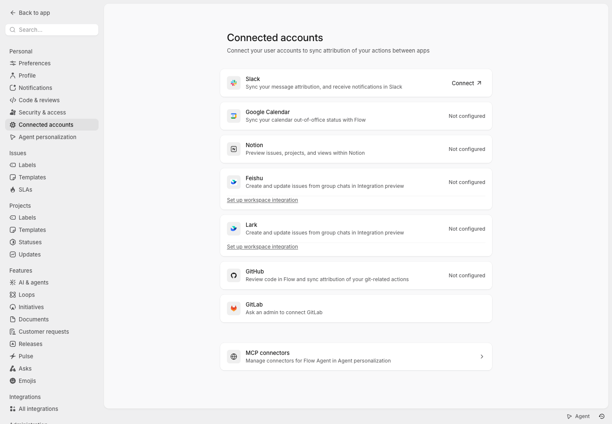

# Feishu and Lark

Flow supports notifications and issue actions through an enterprise custom
application bot. Feishu and Lark are separate integrations with separate app
credentials and tenants. Marketplace applications and group webhook bots are
not supported by this connection flow.

## Connect an application

1. Configure `FLOW_APP_URL` with the public HTTPS origin of Flow. Configure
   `FLOW_CONNECTOR_SECRET_KEY` with a stable base64-encoded 32-byte encryption
   key, shared by all Flow replicas. App credentials are stored in the encrypted
   connector-secret store, not in bootstrap responses or workspace exports.
2. Create a custom application in the [Feishu developer console](https://open.feishu.cn/app)
   or [Lark developer console](https://open.larksuite.com/app). Enable its bot
   capability, set its availability range, and create a version. The
   tenant administrator approves and publishes that version in the admin
   console; this is the tenant authorization (see [Permissions](#permissions)).
3. Grant `im:message:send_as_bot`, `im:message.group_at_msg:readonly`, and
   `im:chat:read`. Flow needs no tenant information or contact scopes, no
   access to all group messages, the contact directory, phone numbers, or
   email addresses.
4. Register the redirect URL
   `https://flow.example.com/api/integrations/feishu/chat/identity/oauth/callback`
   (replace `feishu` with `lark` for Lark, and use your actual Flow origin).
5. In Flow, open **Settings > Integrations > Feishu** or **Lark**. A workspace
   administrator enters the App ID, App Secret, Encrypt Key, and Verification
   Token. Saving obtains a tenant token and reads the bot's info; when both
   succeed, the tenant is authorized automatically. If the version is not
   approved yet, saving reports that and nothing is stored. Blank secret
   fields on subsequent saves preserve the existing encrypted values.
6. Check **Permissions** on the same page: **Tenant** shows the tenant the
   app is connected to, or that the app is not approved yet.
7. Copy Flow's callback URL into the application's HTTP event and callback
   configuration. Enable encryption using the same Encrypt Key and
   Verification Token. Subscribe to `im.message.receive_v1` and the current
   `card.action.trigger` callback; do not also subscribe to the legacy card
   callback. Publish configuration changes when required by the platform.
8. Add the bot to an internal group and allow it to speak. Back in Flow, select
   the group, a team, an optional compatible project/template, and the
   notification and issue-action options. Saving a group binding explicitly
   authorizes disclosing the selected resource summaries to that group; Flow
   records who authorized it and when. Team owners do this from the team's
   notifications page as well.

Use **Test connection** to recheck credentials and bot publication (and with
them the tenant authorization). Event subscription, app availability,
permissions, and group speech settings must also be configured correctly in
the platform console.

## Permissions

A chat integration has three permission domains. Each is granted on its own,
and the settings page shows which one is missing and who can grant it; API
refusals carry a `permissionDomain` (`tenant`, `workspace` or `team`)
next to the stable error `code`.

- **Tenant** (`tenant`). Granted on the chat platform: the tenant
  administrator approves and publishes the custom app's version in the admin
  console (and sets its availability range there). Until then the platform
  does not issue the app a tenant token, so Flow authorizes the tenant
  automatically once the configured App ID and App Secret obtain a
  `tenant_access_token` and the bot's info is readable. Nobody signs in for
  it in Flow, and a Flow workspace role never stands in for it. Flow records
  when it was authorized, the tenant key and the workspace administrator who
  configured or tested the connection. It re-checks on **Test connection**,
  every few hours (every few minutes while the app is not approved) and after
  the platform refuses the app's token. When the token or the bot's info is
  refused, the page shows "The app isn't approved or published in the tenant
  yet, or its credentials are wrong" (`chat_tenant_not_approved`, or
  `chat_bot_unpublished` when the bot capability is off), and notifications
  and group actions stop until the next successful check (updates made in
  between are not sent later). An unreachable
  platform (`chat_platform_unreachable`) never withdraws the authorization.

  The tenant token and bot info do not name the tenant, so the tenant key is
  recorded from the first platform answer under the app's credentials that
  does: the bot's internal groups (only groups of the app's tenant can be
  internal for a custom app's bot), or a member's linked account (only
  accounts of that tenant can authorize a custom app). Once recorded it never
  changes, and every group, account and callback must match it.

  Connections set up while tenant authorization was a sign-in step need
  nothing: authorized ones stay authorized and are rewritten as
  automatically authorized on their next successful check, and ones still
  waiting for the sign-in are authorized by the first successful check.
- **Workspace integration** (`workspace`). Workspace administrators manage the
  application settings and every group binding.
- **Team bindings** (`team`). A team's owners (inherited from parent teams)
  bind its groups; workspace administrators administer every team and so may
  too. Other members cannot create, change, revoke or remove a team's
  bindings, and see none of them.

### Private teams

A private team's owner may bind it to a specific internal group. The binding
records the authorizer, the time, the group, the shared notification types and
project, whether the group may create and update issues, and its revocation.
It never adds team memberships or widens who can see the team in Flow: its
notifications go to that group only, and group actions run as each member's
own linked Flow account with that account's permissions. A private team
binding stops as soon as its authorizer can no longer administer the team.
Projects shared with another private team, issues with their own access
restrictions, and initiatives with a private contributing team are never sent.

Public teams keep working as before; their bindings now also record who
authorized them. Binding a public team needs the same team binding permission,
so the rule is the same for every team.

**Revoke** stops a binding and keeps it listed (with who revoked it and when)
until the group is bound again or the binding is removed. Authorizing,
changing, revoking and removing bindings, the tenant being authorized or
reported as not approved, and the tenant key being recorded are in the audit
log. Entries of the former tenant sign-in and authorizer designation stay
readable there.

Flow still refuses external groups, groups of another tenant, groups the bot
is not in, and accounts or callbacks of another tenant. A member outside the
app's availability range who tries to link their account is told so
(`chat_app_unavailable_to_user`), separately from the tenant state.

## Notifications and issue actions

Notifications can include issue creation, state and assignee changes, new
comments, project updates, and initiative updates (sent to the groups of the
initiative's lead team). They include an approved summary and Flow link;
comment bodies and attachments are not copied to the group.

Group users link their own Flow account from **Personal > Connected accounts**.
Linking does not grant workspace or team membership, and names or email
addresses are never used to match accounts automatically.

### Personal notifications

A member who linked their account can also receive their own Flow
notifications as a direct message from the app's bot: **Personal >
Notifications > Lark** (or **Feishu**) turns them on and chooses the same
notification types as email and desktop. Each message is a card with the
notification's title, a line saying what happened and **Open in Flow**; it
is sent through the chat outbox with its rate limit and retries.

A message is sent only while the tenant is authorized, the account is still
linked and the member is still active in the workspace, and only when they
can still open the issue it links to; workspaces with sensitive data
protection send none. Unlinking or leaving the workspace stops delivery,
including messages already queued. When the platform refuses a message
because the app isn't available to the member's account (its availability
range), the notifications row says so; the next delivered message clears it.

Mention the bot with `@Flow create issue <title>` or `@Flow 创建事项 <title>`.
The bot sends a personal confirmation form with the bound team/project,
title, state, priority, and assignee. After creation it replies to the source
message with an issue card. Shared issue cards open personal forms for state,
assignee, and comment changes, so other group members cannot see a person's
drafts. Ordinary group messages are not synchronized as comments.

Creation uses the target team's effective workflow and default state,
including inherited workflows. A template must be compatible with that
team. Updates carry an expected issue version; stale cards cannot overwrite
newer changes. All actions recheck the actual Flow account's current
membership, resource permissions, and authentication policy. Deactivated or
unlinked accounts cannot continue using old cards.

Only internal groups belonging to the connected tenant can be bound. Private
or restricted teams are included only with their owners' authorization (see
[Private teams](#private-teams)). Workspace policies that disable external
processing also disable this path. Group membership itself never grants Flow
read or write permissions.

## Lark or Feishu as the deployment's chat platform

Set `FLOW_CHAT_PLATFORM=lark` or `feishu` (Helm `integrations.chat.platform`)
to make it the deployment's first-class chat platform. The team home shows
**Connect Lark group** (飞书 for Feishu in Chinese), the team's notifications
page manages its groups, project menus and the project details sidebar open
the project's groups, project and initiative update settings, onboarding and
the integration catalog point to it. The default (`slack`) keeps the Slack
entry points; the other chat integrations stay available in Settings >
Integrations either way.

## Delivery and recovery

Incoming events are authenticated and persisted before they are acknowledged.
Repeated message deliveries use the platform message ID for deduplication.
Issue and comment creation use stable IDs so a worker restart after a commit
cannot create the same item twice.

Notification consumption uses Flow's persisted, commit-ordered domain-event
log. The scheduler retries transient failures and rate limits with bounded
backoff. Database job claims and a workspace execution lease coordinate
multiple replicas, including deployments without Redis. Disconnecting removes
the connection's queued work, group bindings, account bindings, and actions.

The platform only guarantees send-request UUID deduplication for one hour.
Delivery retries use the same UUID, but an unknown result retried outside that
window cannot provide an absolute exactly-once external-delivery guarantee.

Previously sent cards also have platform expiry limits: shared cards can be
updated for 14 days, and interactions expire after 30 days. Use the Flow link
or a current card when an old message is no longer interactive. Individual
confirmation forms expire earlier to prevent stale operations.

Personal card inputs accept up to 1,000 characters, subject to Flow's title
byte limit. State dropdowns contain at most 100 options; assignee dropdowns
contain at most 99 active Flow users plus the unassigned option, retaining
the current or template assignee. Use Flow for a selection outside those
limits. Forms that exceed the card size limit return a Flow link instead.

Keep the domain-event retention window longer than an expected service outage.
If the chat consumer falls behind retained history, Flow reports a cursor
gap instead of silently treating old events as delivered. Already accepted
chat commands can still be processed independently.

## Verification

The repository tests cover mocked platform authorization, encrypted callback
verification, tenant isolation, duplicate events, permissions, workflow
defaults, stale updates, durable creation, and retry/lease behavior. Before
production use, complete a live acceptance run with a published test app and
internal group on each platform: connect, link a member, receive a real
notification, create an issue, change its state/assignee, and add a comment.

### Verify with a test tenant

The "not approved" detection relies on platform behavior the repository tests
can only fake. Confirm it once per platform on a test tenant:

1. Create a custom app with the bot capability and a version, but do not
   approve it yet. In Flow, save its credentials: does
   `/open-apis/auth/v3/tenant_access_token/internal` refuse the token (Flow
   then reports `chat_tenant_not_approved`), or does it issue one? If it
   issues one, does `/open-apis/bot/v3/info/` refuse or return no `open_id`?
   Note the HTTP status and `code` of each.
2. If a token is issued before approval, call `GET /open-apis/im/v1/chats`
   with it and note how the group read fails (status and `code`); Flow lists
   groups only after the tenant check succeeds.
3. Approve and publish the version in the admin console, then select **Test
   connection**: the tenant should show as connected, and the tenant key
   should appear once the bot is in an internal group or a member links an
   account.
4. Remove a test member from the availability range and have them link their
   account: note how the platform refuses (the authorize page itself, the
   token exchange or `/open-apis/authen/v1/user_info`). Flow reports
   `chat_app_unavailable_to_user` when `user_info` refuses the account. For a
   member who linked before being removed from the range, turn on personal
   notifications and confirm that the direct message is refused with code
   `230013`, which Flow shows as "the app isn't available to your account".
5. Withdraw or disable the app in the admin console: the next periodic
   check, or the next delivery after the token is refused, should show the app
   as not approved.

Platform references: [message events](https://open.feishu.cn/document/server-docs/im-v1/message/events/receive),
[sending messages](https://open.feishu.cn/document/server-docs/im-v1/message/create),
[card callbacks](https://open.feishu.cn/document/feishu-cards/card-callback-communication),
[updating cards](https://open.feishu.cn/document/server-docs/im-v1/message-card/patch).
