# Feature tour clips

Short product demos of Flow (English UI, dark theme, invented "Acme" demo
workspace). Every clip exists as a GIF (for READMEs and docs) and as an
H.264 MP4 (sharper, smaller, with the same content).

The clips are generated, not hand-recorded: see
[`scripts/feature-tour`](../../scripts/feature-tour/README.md) to re-record them
after a UI change.

## Core workflow

| Clip | What it shows |
| --- | --- |
| 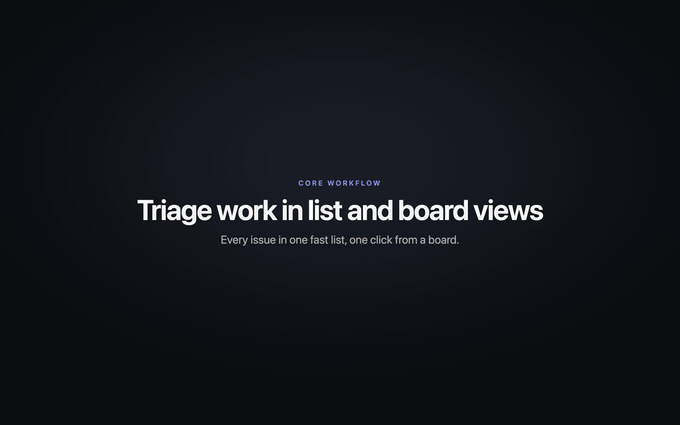 | `issues-board`: the issue list, switching to a board from Display options, and dragging a card to a new status. |
| 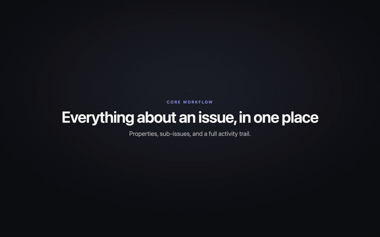 | `issue-detail`: opening an issue, changing a property, sub-issues and the activity feed. |
| 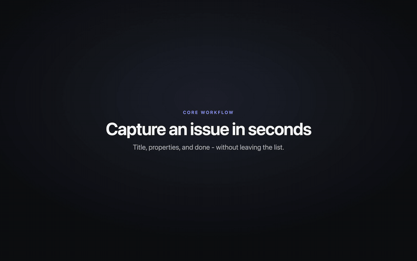 | `issue-create`: the create dialog with title, description, priority, assignee, project and label. |
| 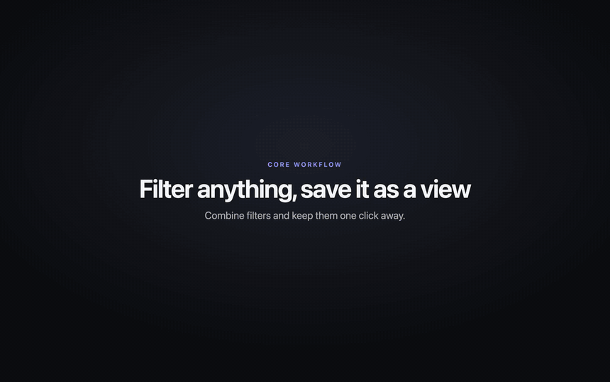 | `filters-views`: combining filters and saving them as a view. |
| 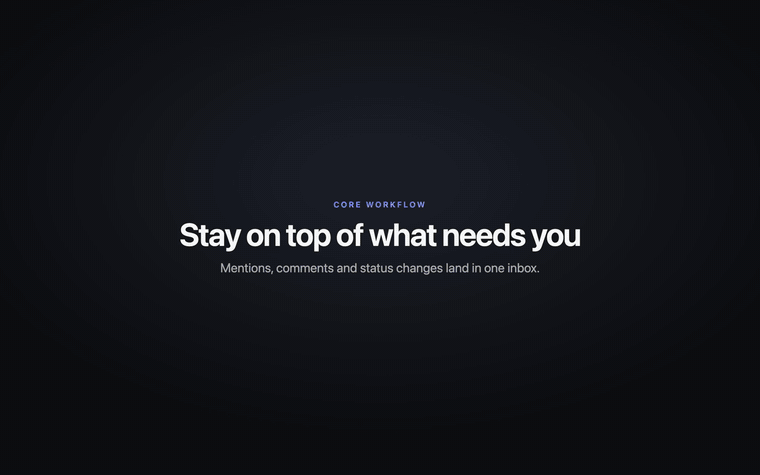 | `inbox`: reading a notification in context and snoozing another. |

## Planning

| Clip | What it shows |
| --- | --- |
| 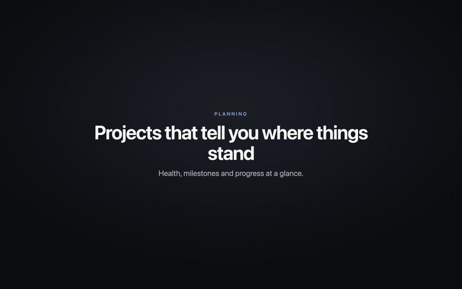 | `projects-overview`: the projects list, then a project's properties, milestones and updates. |
| 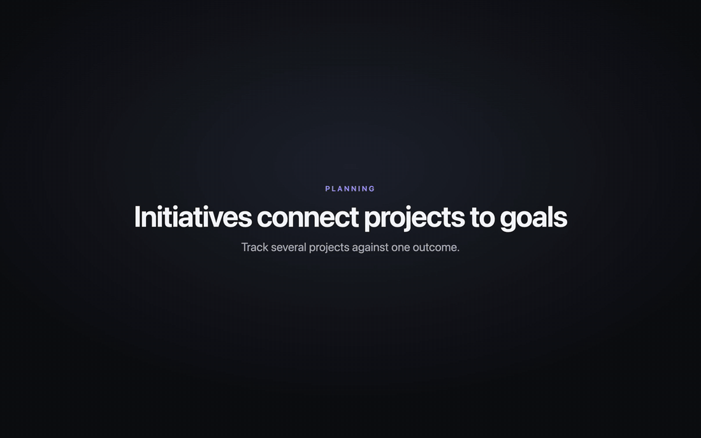 | `initiatives`: initiatives grouping projects toward a goal. |
| 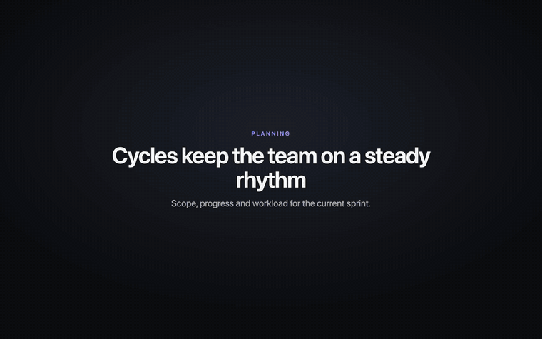 | `cycles`: the current cycle with scope, progress and workload. |
| 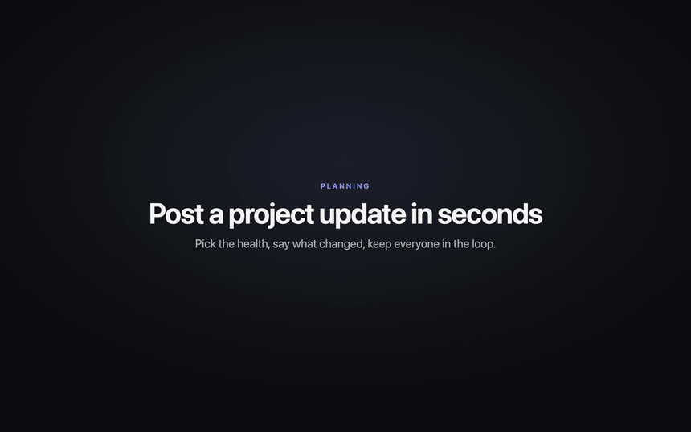 | `project-update`: posting a project update with a health status. |

## Documents and collaboration

| Clip | What it shows |
| --- | --- |
| 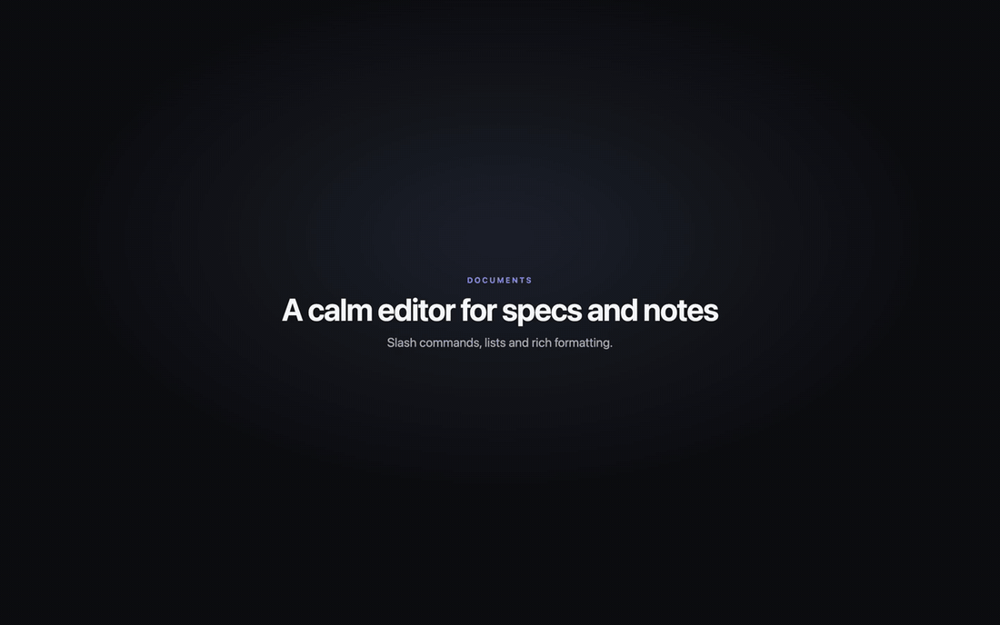 | `doc-editing`: slash commands for a heading and a list, then bold and italic from the selection toolbar. |
| 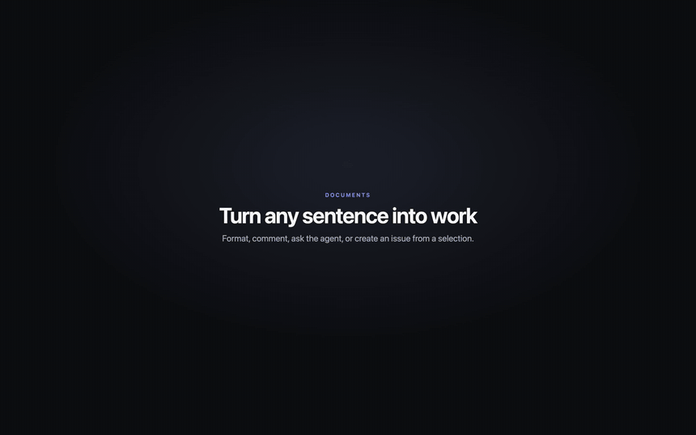 | `doc-selection-toolbar`: the toolbar that appears on a selection, ending in "Create issue from selection". |
| 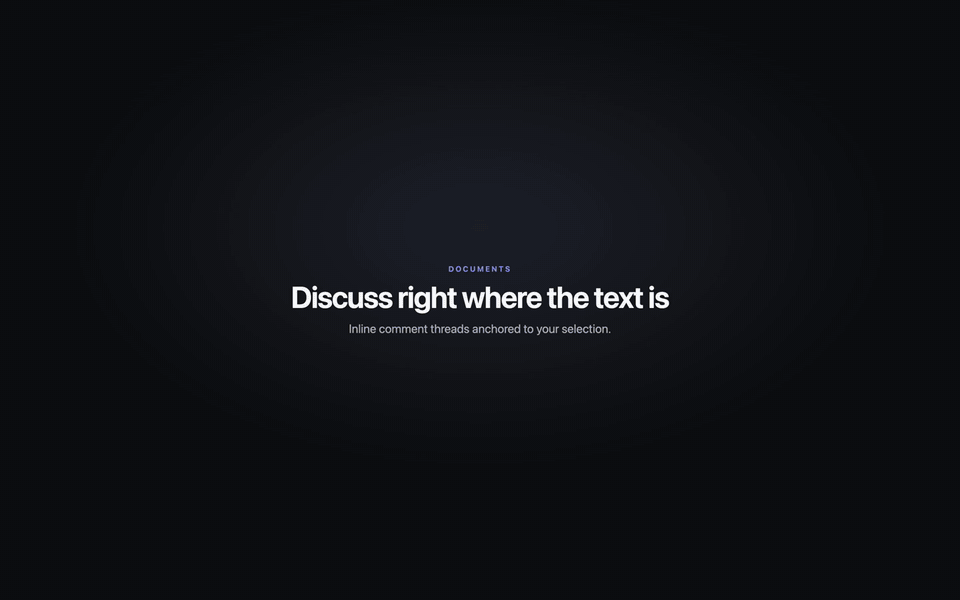 | `doc-comment`: an inline comment thread anchored to a selection, with a reply and a reaction. |
| 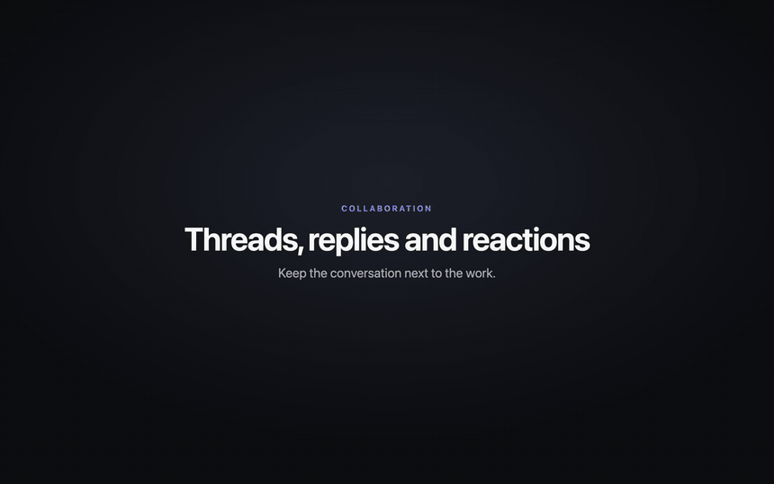 | `issue-comments`: a threaded discussion on an issue with reactions and a reply. |

## Agent

| Clip | What it shows |
| --- | --- |
| 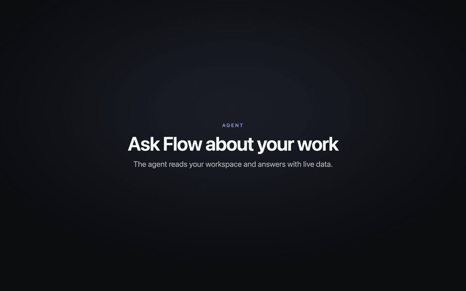 | `agent-chat`: asking the Agent page a question; it uses tools and answers with a table and live issue rows. |
| 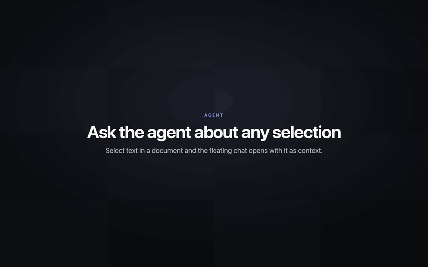 | `agent-floating-chat`: "Ask agent" on a document selection opens the floating chat with that text as context. |
| 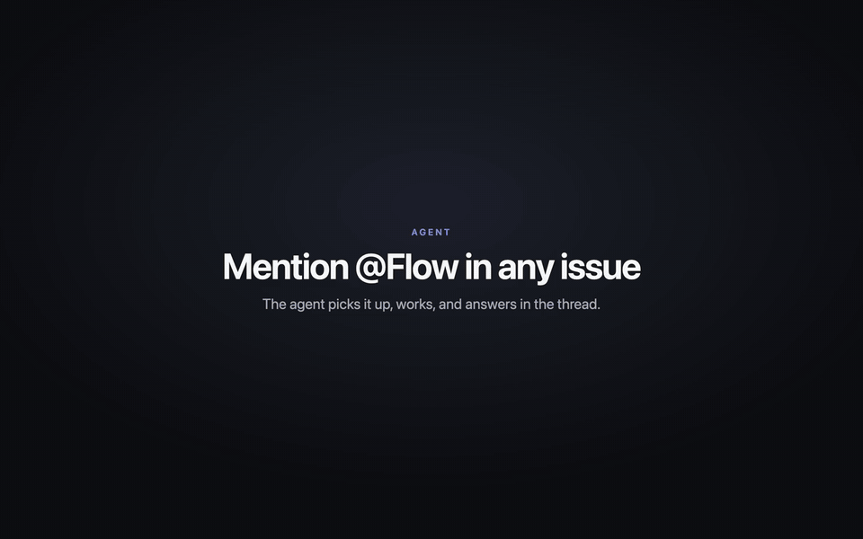 | `agent-mention`: mentioning @Flow in an issue comment; the working row and the reply in the thread. |
| 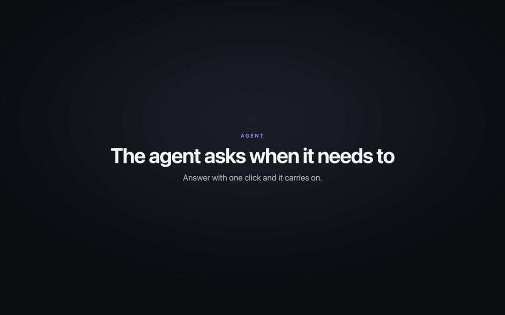 | `agent-options`: the agent asks a clarifying question with option pills, then creates the issue. |

Agent clips use the local model proxy configured in `.claude/launch.json`
(`deepseek-v4.1-flash`), so the wording of replies differs from take to take.
